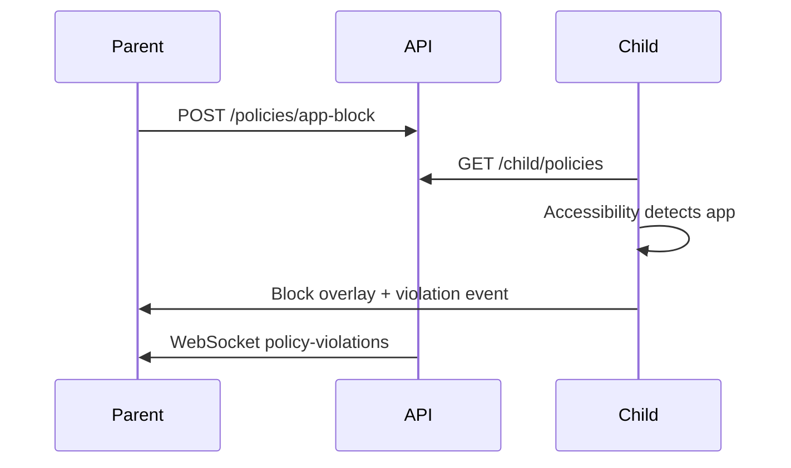
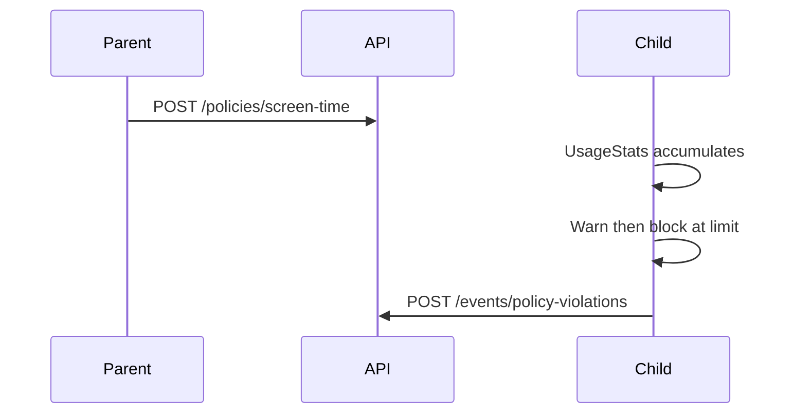
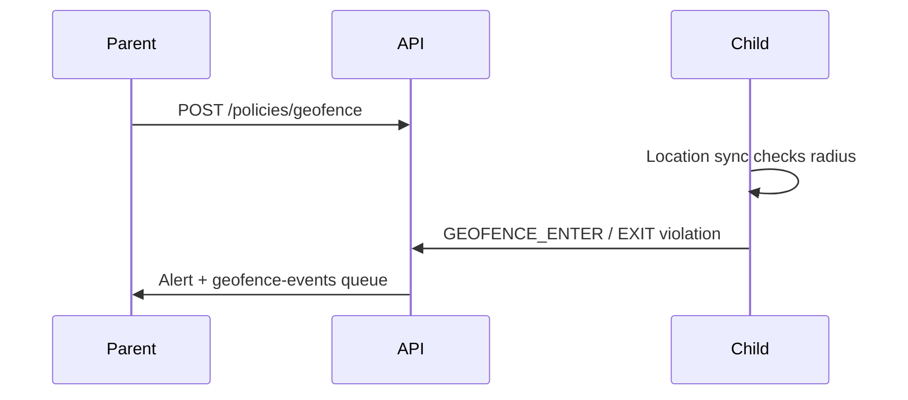
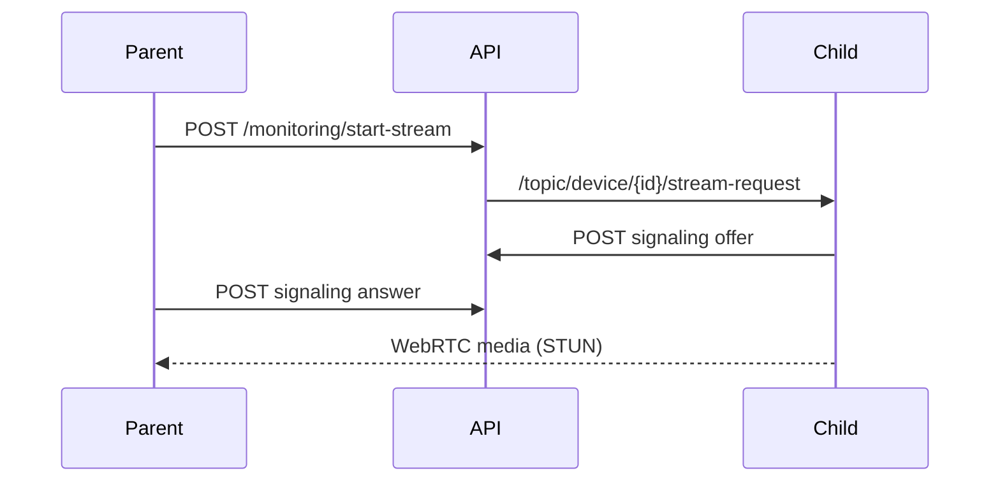
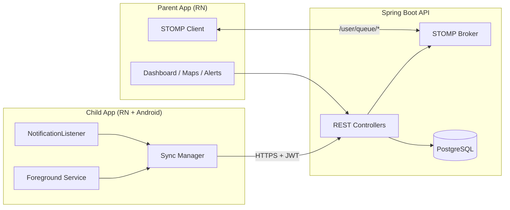
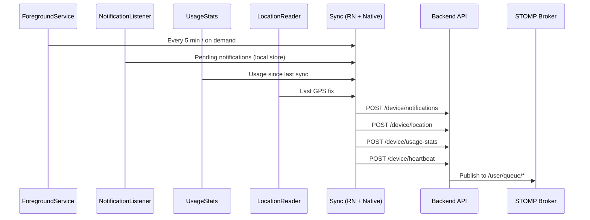
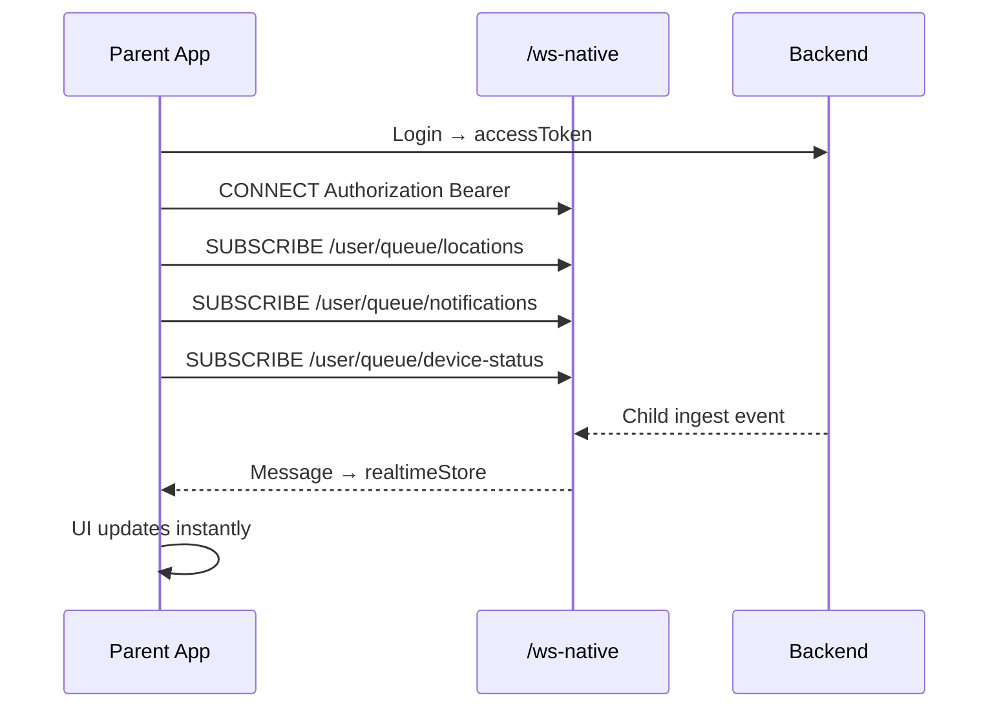

# Parental Control System

A lawful parental monitoring platform with three applications sharing one Spring Boot API.

> **New developer?** Start with the complete setup guide: **[docs/DEVELOPER_ONBOARDING.md](docs/DEVELOPER_ONBOARDING.md)** (backend, parent app, child app, env vars, troubleshooting).

| Component | Stack | Role |
|-----------|-------|------|
| **backend/** | Spring Boot 3, PostgreSQL, STOMP WebSocket | REST API, persistence, real-time events |
| **parent/** | React Native | Parent dashboard, live updates, alerts |
| **child/** | React Native + Android native | Device agent: capture & sync monitoring data |

---

## 1. Project overview

Parents register and pair a child's Android device using an 8-character code. The child app runs a **foreground service** that captures notifications, location, and app usage, then uploads them to the backend. The parent app receives **instant updates** over WebSocket (STOMP) without refreshing.

All monitoring requires **informed consent** on both parent registration and child pairing.

**Silent child operation:** After setup, parent actions (viewing location, notifications, policies, starting live stream) do **not** send alerts or popups on the child device. The child app uses background sync and a minimal required foreground notification only. App-blocking overlays appear only when the child violates a rule, not when the parent views data.

---

## 2. Folder structure

```
parentalControlApp/
├── backend/                 # Spring Boot API (Java 21)
│   └── src/main/java/com/parentalcontrol/
│       ├── auth/            # Register, login, JWT refresh
│       ├── device/          # Pairing, heartbeat, device registry
│       ├── monitoring/      # Notifications, location, usage, alerts, streaming
│       ├── user/            # Parent/child profiles
│       ├── config/          # Security, WebSocket, OpenAPI
│       └── common/          # ApiResponse, JWT, exceptions
├── parent/                  # React Native parent UI
│   └── src/
│       ├── screens/         # Dashboard, devices, notifications, location, alerts
│       ├── services/        # REST + WebSocket (STOMP)
│       └── store/           # Auth + realtime Zustand stores
├── child/                   # React Native child UI + Android native
│   ├── src/services/        # syncService, API client
│   └── android/             # NotificationListener, ForegroundService, BootReceiver
├── docs/                    # Architecture, API, deployment, security
└── docker-compose.yml       # Postgres, Redis, MinIO, API (run via Podman: scripts/dev/compose.sh)
```

---

## 3. Phase 1 deliverables (complete)

- Monorepo layout (`backend/`, `parent/`, `child/`)
- PostgreSQL schema + Flyway `V1__initial_schema.sql`
- Parent registration / login / JWT access + refresh
- Device pairing code (15 min TTL) + QR payload
- Child device pair → device JWT
- Device heartbeat API
- Podman Compose (Postgres, Redis, MinIO) — `./scripts/dev/compose.sh`
- Swagger / OpenAPI
- Integration tests (Testcontainers)

---

## 4. Phase 2 deliverables (complete)

### Backend
- `POST /api/v1/device/notifications` — batch notification ingest
- `POST /api/v1/device/location` — GPS point → `location_history`
- `POST /api/v1/device/usage-stats` — app usage → `app_usage_logs`
- `POST /api/v1/device/heartbeat` — status + telemetry
- Parent read APIs: notifications, location history, usage stats (paginated)
- `GET /api/v1/alerts` — parent alert feed
- STOMP WebSocket: `/ws` (SockJS) and `/ws-native` (React Native)
- Parent user queues: `/user/queue/locations`, `/user/queue/notifications`, `/user/queue/device-status`, `/user/queue/alerts`
- Screen-share signaling stub: `POST /api/v1/monitoring/start-screen-share`
- Low-battery alert on heartbeat

### Child app
- **NotificationCaptureService** — `NotificationListenerService`, local store, sync
- **UsageStatsReader** — `UsageStatsManager`
- **LocationReader** — GPS last-known location
- **MonitoringForegroundService** — persistent sync every 5 min
- **BootReceiver** — restarts monitoring after reboot
- **NativeSyncUploader** — HTTP upload when RN is backgrounded
- React Native **syncService** — periodic RN + native sync

### Parent app
- **@stomp/stompjs** client on `/ws-native` with JWT
- Real-time dashboard, device list, device detail, notifications, location map, alerts
- `realtimeStore` (Zustand) merges WebSocket events with REST data

---

## 5. Phase 3 deliverables (complete)

### Policy engine (backend)
- Normalized tables: `policies`, `app_block_rules`, `screen_time_rules`, `device_schedule_rules`, `geofence_rules`, `streaming_policy_rules`, `policy_assignments`, `policy_sync_state`, `policy_violation_events`
- Parent CRUD: `POST /api/v1/policies/*` (app-block, screen-time, device-schedule, geofence, streaming)
- Child sync: `GET /api/v1/child/policies`, `POST /api/v1/child/policies/ack`
- Violations: `POST /api/v1/events/policy-violations`
- WebSocket: `/user/queue/policy-updates`, `policy-violations`, `geofence-events`, `streaming-state`
- Signaling: `POST/GET /api/v1/monitoring/signaling/{roomId}` + topic `/topic/signaling/{roomId}`

### Child enforcement (Android)
- **PolicySyncManager** — fetches bundle every 5 min (foreground service)
- **AppBlockingAccessibilityService** — blocks apps, shows overlay, reports violations
- **PolicyEnforcementEngine** — app blocks, screen time, bedtime lock
- **GeofenceMonitor** — enter/exit detection on location sync
- **BlockOverlayActivity** — “This app is blocked by your parent”
- **ChildDeviceAdminReceiver** — device administrator (uninstall requires deactivating admin)
- **TamperProtectionManager** — hide launcher icon; re-applied on boot and after pairing

### Parent app
- **Policies** screen — create app blocks, screen time, geofences, bedtime, streaming permissions
- **Live monitoring** — WebRTC viewer (screen / camera / audio) via `react-native-webrtc`
- Real-time policy violation and geofence alerts on WebSocket

### Required Android permissions (Phase 3)
| Permission | Purpose |
|------------|---------|
| Accessibility | Detect foreground app and enforce blocks |
| Usage stats | Screen time tracking |
| Location (incl. background) | Geofence monitoring |
| Camera / Microphone | Live camera and audio streams |
| Media projection | Screen sharing (via WebRTC) |
| Display over other apps | Block overlay (optional enhancement) |

### Phase 3 flow diagrams

**App blocking**


**Screen time**


**Geofence**


**Streaming**


---

## 6. Architecture diagram



---

## 7. Authentication flow

1. **Parent** registers (`POST /api/v1/auth/register`) with `consentAccepted: "true"`.
2. **Parent** logs in → receives `accessToken` + `refreshToken` (`ROLE_PARENT`).
3. **Parent** creates pairing code (`POST /api/v1/devices/pairing-code`).
4. **Child** pairs with code (`POST /api/v1/device/pair`) → receives `deviceToken` (`ROLE_CHILD_DEVICE`).
5. **REST**: `Authorization: Bearer <token>` on all protected routes.
6. **WebSocket**: same Bearer token in STOMP `CONNECT` headers; principal = parent user UUID for `/user/queue/*` routing.

---

## 8. Child monitoring flow



1. User grants notification, usage, and location permissions.
2. Child pairs → `saveSyncConfig` + **ForegroundService** starts.
3. **NotificationCaptureService** writes to local **NotificationStore**.
4. **Sync** reads pending data and POSTs to backend.
5. Backend persists and pushes events to parent WebSocket queues.
6. **BootReceiver** restarts ForegroundService after reboot if device is paired.

---

## 9. Parent real-time flow



---

## 10. API documentation

See [docs/API.md](docs/API.md) for full request/response examples.

| Method | URL | Auth |
|--------|-----|------|
| POST | `/api/v1/auth/register` | Public |
| POST | `/api/v1/auth/login` | Public |
| POST | `/api/v1/devices/pairing-code` | Parent |
| POST | `/api/v1/device/pair` | Public |
| POST | `/api/v1/device/heartbeat` | Device |
| POST | `/api/v1/device/notifications` | Device |
| POST | `/api/v1/device/location` | Device |
| POST | `/api/v1/device/usage-stats` | Device |
| GET | `/api/v1/devices/{id}/notifications` | Parent |
| GET | `/api/v1/devices/{id}/location-history` | Parent |
| GET | `/api/v1/devices/{id}/usage-stats` | Parent |
| GET | `/api/v1/alerts` | Parent |
| WS | `/ws-native` (STOMP) | Parent Bearer |

---

## 11. Android permissions

| Permission | Purpose |
|------------|---------|
| `INTERNET` | Upload monitoring data |
| `ACCESS_FINE_LOCATION` / `COARSE` | GPS location history |
| `ACCESS_BACKGROUND_LOCATION` | Location while service runs |
| `FOREGROUND_SERVICE` / `LOCATION` | Persistent monitoring service |
| `RECEIVE_BOOT_COMPLETED` | Restart monitoring after reboot |
| `POST_NOTIFICATIONS` | Foreground service notification (Android 13+) |
| `PACKAGE_USAGE_STATS` | App screen-time via UsageStatsManager |
| Notification listener (special access) | Capture notification content |

---

## 12. Setup instructions

### Prerequisites

- Java 21, Maven 3.9+
- Node 18+, React Native CLI
- **Podman** (required for local Postgres, Redis, etc.) — do not use Docker CLI
- Android Studio + device/emulator for child app

### Backend

```bash
./scripts/dev/compose.sh up -d postgres redis minio
cd backend
cp .env.example .env
mvn clean install
mvn spring-boot:run
# API: http://localhost:8080
# Swagger: http://localhost:8080/swagger-ui.html
```

### Parent app

```bash
cd parent
npm install
cp .env.example .env
npm start
# New terminal:
npm run android
```

### Child app

```bash
cd child
npm install
cp .env.example .env
# Generate android/ if missing: npx @react-native-community/cli init (see child/README.md)
# Merge android/app/src/main/AndroidManifest.xml services into your RN manifest
npm run android
```

**Emulator API URL:** `http://10.0.2.2:8080` (Android maps host loopback).

---

## 13. Testing guide (Phases 1–3)

### 1. Pair devices

1. Start backend + parent app → register & login.
2. **Device list** → **Generate pairing code**.
3. Child app → grant permissions → enter code → **Pair device**.
4. Confirm foreground notification "Parental monitoring active" on child device.

### 2. Notification sync

1. On child device, trigger a notification (e.g. message app).
2. Wait up to 5 min or tap **Sync now** on child **Service status** screen.
3. Parent app → device → **Notifications** — new entry appears (live or after pull-to-refresh).

### 3. Location sync

1. Grant location on child device.
2. Sync runs → parent **Location** screen shows map marker (live update when WebSocket connected).

### 4. Usage stats sync

1. Grant **Usage access** in child permission setup.
2. Use apps on child device, then sync.
3. Verify `GET /api/v1/devices/{id}/usage-stats` in Swagger or parent API logs.

### 5. Real-time updates

1. Parent dashboard shows **Live updates: Connected**.
2. Trigger child heartbeat or sync — battery/status updates on dashboard without refresh.

### 6. Reboot persistence

1. Reboot child device.
2. Foreground service should restart automatically when paired.
3. Confirm sync resumes (check backend logs or parent last-seen).

### 7. App blocking (Phase 3)

1. Parent → device → **Policies** → block `com.android.chrome` (or another app).
2. Wait for child policy sync (~5 min) or reboot foreground service.
3. Open blocked app on child — overlay appears, app sent to home.

### 8. Screen time (Phase 3)

1. Create screen time policy (e.g. 1 minute limit for testing).
2. Use the app on child until limit — warning then block.

### 9. Geofence (Phase 3)

1. Create geofence at current coordinates with small radius.
2. Move device in/out of radius — parent receives geofence alert.

### 10. Live streaming (Phase 3)

1. Parent → **Live monitoring** → **Screen share** (or Camera/Audio).
2. Child app polls pending sessions and starts WebRTC offer.
3. Parent viewer shows stream when peer connection completes (requires `npm install` + native rebuild for `react-native-webrtc`).

### 11. Device admin & hide launcher (Phase 3)

1. Child app → **Grant permissions** → **Device administrator** → accept system prompt.
2. Toggle **Hide app from launcher** (requires active device admin).
3. Confirm app icon disappears from home screen; tap **Parental monitoring active** notification to reopen.
4. Reboot device — foreground service and hidden launcher state should persist.
5. To uninstall: Settings → Security → Device admin apps → deactivate, then uninstall.

### Automated backend tests

```bash
cd backend && mvn test
```

---

## 14. Known limitations

| Item | Status |
|------|--------|
| TURN server for WebRTC behind strict NAT | Configure `TURN_*` env; STUN only by default |
| Hosted Stripe / production pins | Set keys + `network_security_config` pins |
| Three separate Git repos | Use `scripts/split-repos.sh` when ready |
| iOS | **Not planned** — Android child agent only |
| FCM instant command delivery | Optional — install `google-services.json`, set `FCM_ENABLED` + `FCM_SERVER_KEY`; validate with `./scripts/dev/validate-fcm-doze.sh` |
| Device Owner | Optional; ADB or QR — see child/README.md |

---

## Quick commands

| Project | Command |
|---------|---------|
| Backend | `cd backend && mvn spring-boot:run` |
| Parent | `cd parent && npm run android` |
| Child | `cd child && npm run android` |
| All infra | `./scripts/dev/compose.sh up -d` |

## Legal

For **lawful parental monitoring** with informed consent only. Comply with local privacy laws and app-store policies.

---

## Secret management and rotation

**Before deploying**, copy `.env.example` to `.env` (and per-app `backend/.env`, `parent/.env`, `child/.env`) and set strong unique values for every secret. Never commit `.env` files.

| Rule | Detail |
|------|--------|
| Server-only | `JWT_SECRET`, `APP_ENCRYPTION_KEY`, `STRIPE_SECRET_KEY`, `STRIPE_WEBHOOK_SECRET`, `FCM_SERVER_KEY`, database passwords, OAuth client secrets |
| Never client-side | Stripe secret keys, Supabase service role keys, JWT signing secrets |
| Mobile apps | Only public-safe config (API base URLs). `TAMPER_MASTER_PIN` is dev-only and must be empty in release builds |
| No `REACT_APP_` / `NEXT_PUBLIC_` for secrets | These prefixes expose values to the browser bundle |

**Git history warning:** This repository previously contained hardcoded credentials (including a tamper master PIN and local database passwords). Those values remain in git history even after removal. **Rotate every secret that was ever committed** — treat old values as compromised. Use new JWT signing keys, database passwords, TURN secrets, Stripe keys, Firebase service accounts, and tamper PINs before any production deployment.
