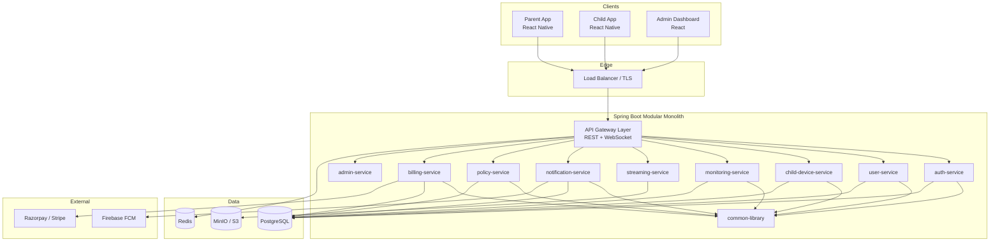
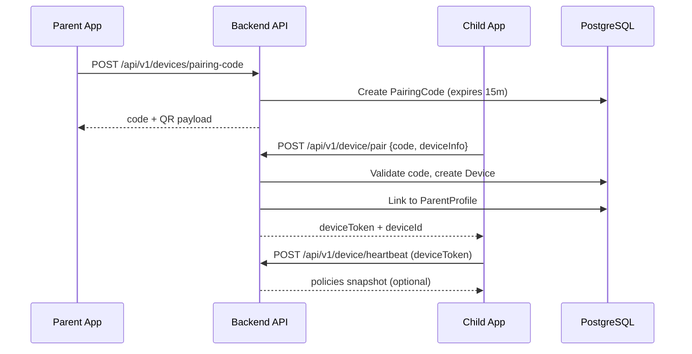

# Parental Control Platform — Architecture

## High-Level Overview



## Communication Patterns

| Pattern | Use Case |
|---------|----------|
| REST (JWT) | Auth, settings, historical data, billing |
| WebSocket (STOMP) | Live session control, online status, alerts |
| WebRTC (TURN/STUN) | Screen mirror, camera, audio streams |
| FCM | Push when device offline / background |

## Monorepo Layout

| Folder | Responsibility |
|--------|----------------|
| **backend/** | Single Spring Boot app — auth, users, devices, monitoring (phased) |
| **parent/** | React Native parent UI |
| **child/** | React Native child agent + Android native modules |
| **docs/** | Architecture, API, deployment, security |

### Backend packages (`com.parentalcontrol`)

| Package | Responsibility |
|---------|----------------|
| `common` | Base entities, JWT, exceptions, API envelope |
| `auth` | Registration, login, refresh tokens |
| `user` | Parent/child profiles |
| `device` | Pairing, heartbeat, device registry |
| `config` | Security, WebSocket, OpenAPI |

## Security Layers

1. **TLS** termination at load balancer
2. **JWT** access tokens (15 min) + refresh tokens (7 days)
3. **Device tokens** for child APIs (scoped to device ID)
4. **Request signing** (HMAC) for child device payloads (Phase 2+)
5. **Rate limiting** via Redis (Phase 2+)
6. **Audit log** for sensitive parent actions

## Device Pairing Flow



## Deployment Topology (Production)

```
┌─────────────┐     ┌──────────────┐     ┌─────────────┐
│  React      │     │  Spring Boot │     │ PostgreSQL  │
│  Native x2  │────▶│  (K8s pods)  │────▶│  (RDS)      │
└─────────────┘     └──────┬───────┘     └─────────────┘
                           │
                    ┌──────┴───────┐
                    │ Redis Cluster│
                    │ MinIO / S3   │
                    └──────────────┘
```

## Phase Roadmap

| Phase | Scope |
|-------|--------|
| **1** (current) | Auth, pairing, heartbeat, schema, Podman |
| **2** | Screen/camera/audio streaming, WebSocket |
| **3** | Policies, geofencing, app blocking |
| **4** | Billing, subscriptions |
| **5** | Kafka, horizontal scale, observability |

## Legal & Consent

- Parent must accept Terms of Service and monitoring disclaimer at registration.
- Child device setup wizard displays consent notice (jurisdiction-dependent).
- Anti-tampering uses **Device Owner / Device Admin** APIs only — no unauthorized reinstall.
