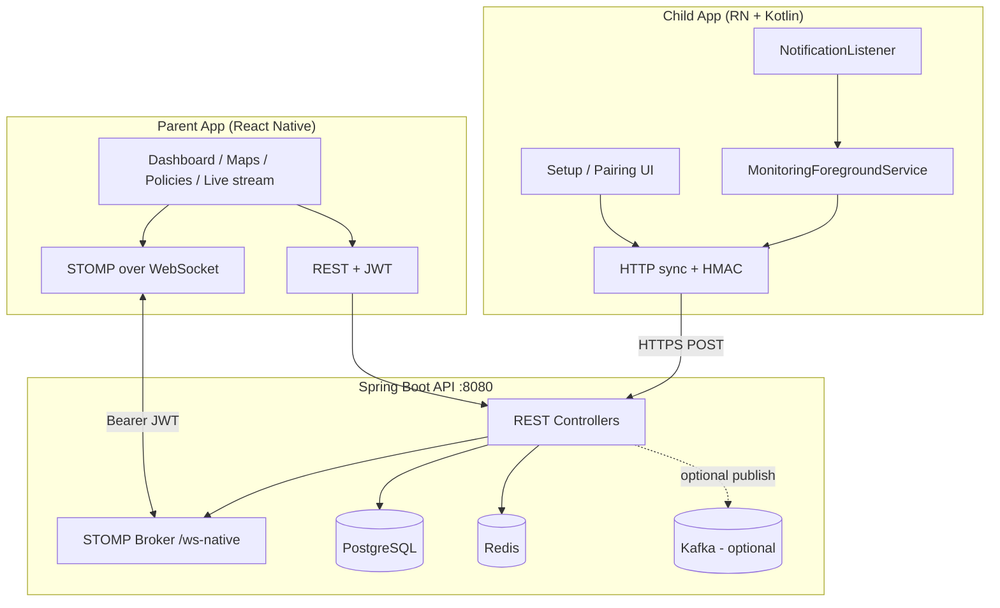
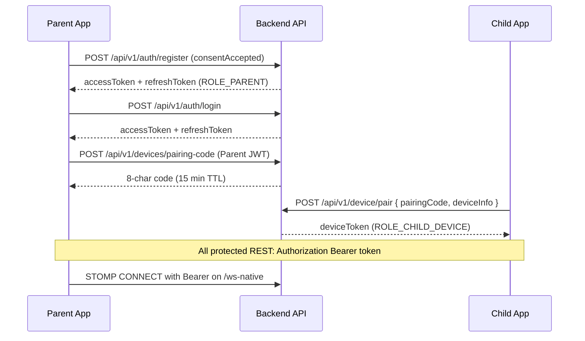
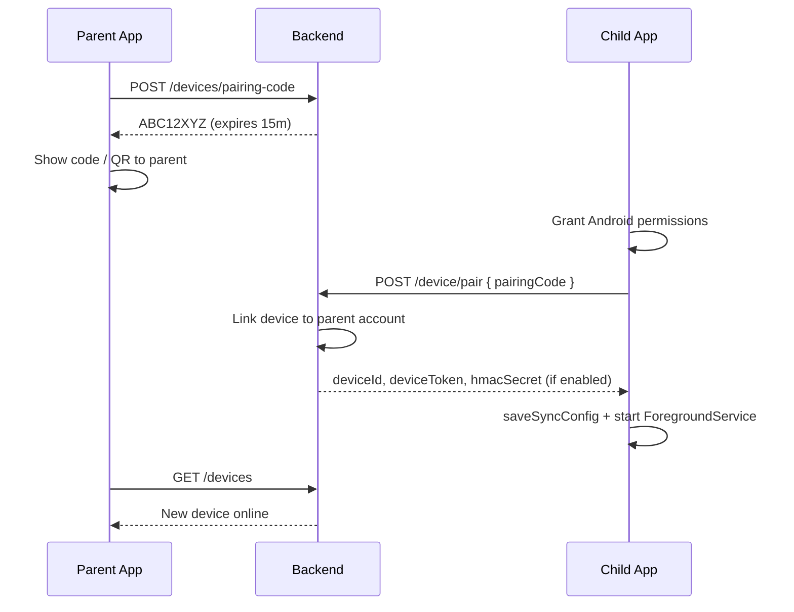
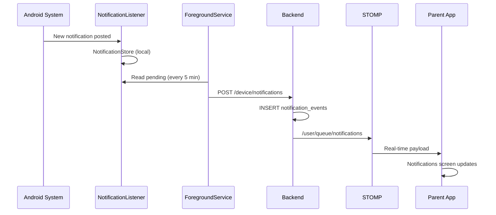
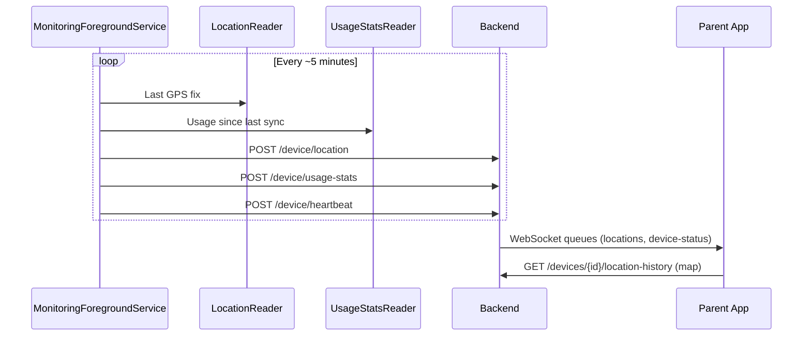

# Parental Control Platform — Developer Onboarding & Startup Guide

Complete guide for new developers setting up the **backend**, **parent app**, and **child app** locally.

| Document | Purpose |
|----------|---------|
| This guide | First-time setup, architecture, env vars, troubleshooting |
| [API.md](./API.md) | Request/response examples |
| [IMPLEMENTATION_PLAN.md](./IMPLEMENTATION_PLAN.md) | Phase completion checklist |
| [SECURITY.md](./SECURITY.md) | HMAC, rate limits, audit |
| [BILLING.md](./BILLING.md) | Stripe, plans, feature gates |
| [OPS.md](./OPS.md) | CI, Helm, Kafka ops |
| Root [README.md](../README.md) | Product overview & phase summary |

---

## Table of contents

1. [Project overview](#1-project-overview)
2. [Tech stack](#2-tech-stack)
3. [Repository structure](#3-repository-structure)
4. [Backend setup guide](#4-backend-setup-guide)
5. [Parent Android app setup](#5-parent-android-app-setup)
6. [Child Android app setup](#6-child-android-app-setup)
7. [Running the full system locally](#7-running-the-full-system-locally)
8. [Environment variables](#8-environment-variables)
9. [Build & release guide](#9-build--release-guide)
10. [Troubleshooting](#10-troubleshooting)
11. [Security notes](#11-security-notes)
12. [Developer notes](#12-developer-notes)

---

## 1. Project overview

### Purpose of each component

| Component | Path | Purpose |
|-----------|------|---------|
| **Backend API** | `backend/` | Single Spring Boot service: auth, device registry, monitoring ingest, policies, WebRTC signaling, billing, audit, remote commands |
| **Parent app** | `parent-app/` | React Native dashboard for parents: register/login, pair devices, view notifications/location/usage, manage policies, live WebRTC monitoring, subscription, audit log |
| **Child app** | `child-app/` | React Native UI + **Android native agent**: captures notifications/location/usage, enforces policies, streams media, runs foreground service, optional Device Owner / kiosk |

**Legal scope:** Lawful parental monitoring with **informed consent** on parent registration and child pairing. Android child agent only — **no iOS**.

### How the three systems communicate



| Channel | Protocol | Used for |
|---------|----------|----------|
| REST | HTTPS (HTTP in dev) | Auth, pairing, ingest, policies, billing, commands |
| WebSocket | STOMP on `/ws-native` | Real-time location, notifications, alerts, policy events to parent |
| WebRTC | P2P + STUN/TURN | Live screen / camera / audio (signaling via REST + STOMP) |
| Child sync | HTTP polling (~5 min) + foreground service | Monitoring upload; remote commands (kiosk) — **not FCM yet** |

### Architecture flow (data plane)

1. Child captures events locally (notifications, GPS, usage stats).
2. Child uploads batches via `POST /api/v1/device/*` with **device JWT** (and optional **HMAC** in production).
3. Backend persists to PostgreSQL and publishes to parent STOMP queues (`/user/queue/*`).
4. Parent UI updates from WebSocket + REST refresh.
5. Policies: parent creates rules → child pulls `GET /api/v1/child/policies` → native enforcement (accessibility, geofence, screen time).

### Authentication flow



| Token | Role | Typical TTL | Used by |
|-------|------|-------------|---------|
| Parent access | `ROLE_PARENT` | 15 minutes | Parent REST + WebSocket |
| Parent refresh | — | 7 days | `POST /api/v1/auth/refresh` |
| Device token | `ROLE_CHILD_DEVICE` | Long-lived (~1 year) | Child REST ingest |

### Device pairing flow



### Notification flow



### Monitoring flow (location, usage, heartbeat)



---

## 2. Tech stack

### Recommended versions

| Technology | Version | Where |
|------------|---------|-------|
| Java | **21** (Temurin) | Backend |
| Spring Boot | **3.4.5** | Backend |
| Maven | **3.9+** | Backend build |
| PostgreSQL | **16** | Database |
| Redis | **7** | Rate limits, HMAC nonces |
| Kafka | **3.7** (Bitnami image) | Optional async ingest |
| Node.js | **18+** (LTS 20 recommended) | React Native |
| npm | **9+** | Package manager (project uses npm, not Yarn) |
| React Native | **0.76.5** | Parent + child apps |
| React | **18.3.1** | Parent + child apps |
| TypeScript | **5.6+** | Mobile apps |
| Android SDK | API **34** target, min **26** typical | Gradle |
| Gradle | **8.x** (via RN template) | Android builds |
| **Podman** | Latest Desktop | Local infra (required — do not use Docker CLI) |
| STOMP | `@stomp/stompjs` **7.1** | Parent WebSocket client |
| WebRTC | `react-native-webrtc` **124** | Live monitoring |

### Prerequisites checklist

- [ ] **Java 21** — `java -version`
- [ ] **Maven 3.9+** — `mvn -version`
- [ ] **Node 18+** — `node -v` and `npm -v`
- [ ] **Android Studio** (Ladybug or newer) with SDK Platform 34, Build-Tools, NDK if prompted
- [ ] **ANDROID_HOME** set — e.g. `$HOME/Library/Android/sdk` on macOS
- [ ] **JAVA_HOME** — JDK 17 or 21 (RN 0.76 often uses 17 for Gradle; backend uses 21)
- [ ] **Podman Desktop** — for Postgres + Redis (`brew install podman` on macOS)
- [ ] Two Android emulators or one emulator + one physical device (parent + child)
- [ ] `adb` on PATH from Android SDK platform-tools

### Firebase note

The child app supports **FCM high-priority data wakes** when `google-services.json` is installed. Without Firebase config, commands and stream requests still use **HTTP polling** (15s native + 5 min sync). Install Firebase config with `./scripts/dev/install-google-services.sh` and enable `FCM_ENABLED` + `FCM_SERVER_KEY` on the backend.

---

## 3. Repository structure

### Monorepo layout

```
parentalControlApp/
├── backend/                 # Spring Boot API
├── parent-app/              # React Native parent dashboard
├── child-app/               # React Native + Android native agent
├── docs/                    # Architecture, API, security, this guide
├── helm/                    # Kubernetes chart for API
├── scripts/                 # split-repos.sh, export-openapi.sh
├── docker-compose.yml       # Postgres, Redis, MinIO, Kafka (Podman: scripts/dev/compose.sh)
└── .github/workflows/       # CI per component
```

### Backend (`backend/`)

```
backend/
├── src/main/java/com/parentalcontrol/
│   ├── ParentalControlApplication.java
│   ├── auth/                 # Register, login, refresh JWT
│   ├── user/                 # Profiles, parent PIN
│   ├── device/               # Pairing, heartbeat, commands, HMAC
│   ├── monitoring/           # Ingest, alerts, streaming, signaling, kafka
│   ├── policy/               # Policy CRUD, child sync, violations
│   ├── billing/              # Stripe, subscriptions, feature gates
│   ├── audit/                # Parent audit log queries
│   ├── config/               # Security, WebSocket, Kafka, rate limit
│   └── common/               # JWT, exceptions, encryption helpers
├── src/main/resources/
│   ├── application.yml       # Defaults + env placeholders
│   └── db/migration/         # Flyway V1–V5
├── src/test/java/            # Testcontainers integration tests
├── pom.xml
├── Dockerfile
├── .env.example
└── README.md                 # Quick start (links here)
```

### Parent app (`parent-app/`)

```
parent-app/
├── src/
│   ├── screens/              # Login, Dashboard, Devices, Policies, LiveMonitoring, etc.
│   ├── navigation/           # RootNavigator, auth stack
│   ├── services/             # api.ts, websocket.ts, webrtc
│   └── store/                # authStore, realtimeStore (Zustand)
├── App.tsx
├── index.js
├── package.json
├── .env.example
└── android/                  # ⚠️ Must be bootstrapped — see Section 5
```

### Child app (`child-app/`)

```
child-app/
├── src/
│   ├── screens/              # Setup, Permissions, Pairing, DeviceOwner, ServiceStatus
│   ├── services/             # syncService, api client
│   └── nativeModules/        # Bridge to Kotlin
├── android/
│   └── app/src/main/
│       ├── AndroidManifest.xml    # Services, receivers, permissions
│       └── java/com/childmonitor/ # 31+ Kotlin modules (monitoring, DO, kiosk)
├── package.json
└── .env.example
```

**Important:** Child app has native Kotlin but may lack full Gradle wrapper (`gradlew`) until bootstrapped (Section 6).

---

## 4. Backend setup guide

### 4.1 Clone and enter repo

```bash
git clone <your-repo-url> parentalControlApp
cd parentalControlApp
```

### 4.2 Start infrastructure (Podman only)

Use the repo wrapper — **never run `docker` or bare `docker compose`**:

```bash
./scripts/dev/compose.sh up -d postgres redis
# Optional:
./scripts/dev/compose.sh up -d minio
./scripts/dev/compose.sh up -d kafka    # only if KAFKA_ENABLED=true
./scripts/dev/compose.sh up -d coturn   # WebRTC TURN for live monitoring
```

Verify:

```bash
./scripts/dev/compose.sh ps
# Or: podman ps
# Expect: pcp-postgres, pcp-redis — Up (healthy)
```

| Service | Host port | Credentials |
|---------|-----------|-------------|
| PostgreSQL | 5432 | DB `parental_control`, user `pcp`, password `pcp_secret` |
| Redis | 6379 | No password (local) |
| MinIO | 9000 / 9001 | `minioadmin` / `minioadmin` |
| Kafka | 9092 | Plaintext (dev only) |

### 4.3 Environment file

```bash
cd backend
cp .env.example .env
```

**Recommended local `.env` (free dev, no Stripe/Kafka/HMAC):**

```env
SPRING_DATASOURCE_URL=jdbc:postgresql://localhost:5432/parental_control
SPRING_DATASOURCE_USERNAME=pcp
SPRING_DATASOURCE_PASSWORD=pcp_secret
SPRING_DATA_REDIS_HOST=localhost
SPRING_DATA_REDIS_PORT=6379
JWT_SECRET=dev-local-jwt-secret-minimum-32-characters-long!!
HMAC_REQUIRED=false
RATE_LIMIT_ENABLED=true
BILLING_ENFORCEMENT=false
KAFKA_ENABLED=false
KAFKA_BOOTSTRAP_SERVERS=localhost:9092
APP_ENCRYPTION_ENABLED=false
APP_ENCRYPTION_KEY=dev-only-change-in-production-32chars!!
STRIPE_SECRET_KEY=
STRIPE_WEBHOOK_SECRET=
STRIPE_PRICE_STANDARD=
STRIPE_PRICE_FAMILY=
SERVER_PORT=8080
```

Export for Spring (macOS/Linux):

```bash
set -a && source .env && set +a
```

Or rely on Spring’s `${VAR}` resolution from the environment when starting Maven.

### 4.4 Example `application.yml` (committed defaults)

Key sections from `backend/src/main/resources/application.yml`:

```yaml
spring:
  datasource:
    url: ${SPRING_DATASOURCE_URL:jdbc:postgresql://localhost:5432/parental_control}
    username: ${SPRING_DATASOURCE_USERNAME:pcp}
    password: ${SPRING_DATASOURCE_PASSWORD:pcp_secret}
  flyway:
    enabled: true
    locations: classpath:db/migration
  data:
    redis:
      host: ${SPRING_DATA_REDIS_HOST:localhost}
      port: ${SPRING_DATA_REDIS_PORT:6379}

server:
  port: 8080

app:
  hmac:
    required: ${HMAC_REQUIRED:false}
  billing:
    enforcement-enabled: ${BILLING_ENFORCEMENT:true}
    trial-days: 14
  kafka:
    enabled: ${KAFKA_ENABLED:false}
  jwt:
    secret: ${JWT_SECRET:change-me-in-production-use-256-bit-minimum-secret-key!!}
    access-token-expiration-ms: 900000
```

> **Note:** Default `BILLING_ENFORCEMENT` in YAML is `true`; override with `.env` `false` for local testing.

### 4.5 Database migrations (Flyway)

Migrations run **automatically** on startup:

| Version | File | Contents |
|---------|------|----------|
| V1 | `V1__initial_schema.sql` | Users, devices, monitoring tables |
| V2 | `V2__phase3_policies.sql` | Policies, rules, violations, signaling |
| V3 | `V3__phase35_device_owner.sql` | Device owner capabilities |
| V4 | `V4__security_kiosk_commands.sql` | HMAC secrets, commands, audit |
| V5 | `V5__billing_provider_fields.sql` | Subscriptions, Stripe metadata |

Manual check:

```bash
podman exec -it pcp-postgres psql -U pcp -d parental_control -c '\dt'
```

### 4.6 Install dependencies and run

```bash
cd backend
mvn clean install -DskipTests
mvn spring-boot:run
```

**With tests** (requires Podman for Testcontainers):

```bash
# Point Testcontainers at Podman (macOS — run once per shell):
export DOCKER_HOST="unix://$(podman machine inspect --format '{{.ConnectionInfo.PodmanSocket.Path}}')"
cd backend && mvn test
```

### 4.7 Verify backend health

```bash
curl -s http://localhost:8080/actuator/health | jq .
```

Expected: `"status":"UP"` (when DB and Redis are reachable).

| URL | Purpose |
|-----|---------|
| http://localhost:8080 | API base |
| http://localhost:8080/swagger-ui.html | Swagger UI |
| http://localhost:8080/api-docs | OpenAPI JSON |
| http://localhost:8080/actuator/prometheus | Metrics (when exposed) |

### 4.8 Run backend in Podman (optional)

From repo root:

```bash
./scripts/dev/compose.sh up -d postgres redis kafka
./scripts/dev/compose.sh up -d backend
```

Container env uses internal hostnames `postgres`, `redis`, `kafka`.

### 4.9 API base URLs for clients

| Client | Base URL |
|--------|----------|
| Browser / curl on Mac | `http://localhost:8080` |
| Android emulator | `http://10.0.2.2:8080` |
| Physical phone (same Wi‑Fi) | `http://<MAC_LAN_IP>:8080` |

Find Mac IP:

```bash
ipconfig getifaddr en0
```

### 4.10 Backend troubleshooting

| Symptom | Fix |
|---------|-----|
| `Connection refused` on 5432 | Start `./scripts/dev/compose.sh up -d postgres`; check `podman ps` |
| `Port 5432 already in use` | Stop local Postgres: `brew services stop postgresql@16` OR stop Podman postgres |
| Flyway migration failed | Drop volume: `./scripts/dev/compose.sh down -v` (destroys data) and restart |
| Redis connection error | `./scripts/dev/compose.sh up -d redis` |
| Kafka errors with `KAFKA_ENABLED=false` | Ensure `.env` has `KAFKA_ENABLED=false` |
| `401` on parent routes | Refresh token or re-login; check `Authorization: Bearer` header |

---

## 5. Parent Android app setup

### 5.1 Prerequisites

- Node 18+, npm
- Android Studio, SDK 34
- JDK 17 for Gradle (Android Studio bundled JDK is fine)

```bash
# macOS — typical paths
export ANDROID_HOME=$HOME/Library/Android/sdk
export PATH=$ANDROID_HOME/platform-tools:$ANDROID_HOME/emulator:$PATH
export JAVA_HOME="/Applications/Android Studio.app/Contents/jbr/Contents/Home"
```

### 5.2 Install dependencies

```bash
cd parent-app
npm install
```

### 5.3 Bootstrap Android project (required once)

The repo may only contain `parent-app/android/README.md`. Generate RN **0.76.5** Android shell:

```bash
npx @react-native-community/cli@latest init ParentScaffold \
  --version 0.76.5 \
  --directory /tmp/pcp-parent-scaffold \
  --skip-install

cp -R /tmp/pcp-parent-scaffold/android parent-app/
chmod +x parent-app/android/gradlew
echo "sdk.dir=$HOME/Library/Android/sdk" > parent-app/android/local.properties
```

Do **not** overwrite `parent-app/src/`, `App.tsx`, or `package.json`.

### 5.4 Configure API URLs

Edit `parent-app/src/utils/config.ts` or set env before Metro (defaults are emulator-friendly):

```typescript
// parent-app/src/utils/config.ts — defaults
apiBaseUrl: 'http://10.0.2.2:8080',
wsNativeUrl: 'ws://10.0.2.2:8080/ws-native',
```

**Physical device** — use Mac LAN IP:

```typescript
apiBaseUrl: 'http://192.168.1.42:8080',
wsNativeUrl: 'ws://192.168.1.42:8080/ws-native',
```

Copy `parent-app/.env.example` for reference (requires `react-native-config` if you wire it later):

```env
API_BASE_URL=http://10.0.2.2:8080
WS_BASE_URL=http://10.0.2.2:8080/ws
WS_NATIVE_URL=ws://10.0.2.2:8080/ws-native
```

### 5.5 Firebase / google-services.json (child app FCM)

1. Create a Firebase project and add Android app `com.childmonitor`.
2. Download `google-services.json` or run `./scripts/dev/install-google-services.sh /path/to/file`.
3. Rebuild and reinstall the child APK.
4. Set backend `FCM_ENABLED=true` and `FCM_SERVER_KEY` (Firebase Console → Cloud Messaging → Server key).
5. Validate Doze wake: `./scripts/dev/validate-fcm-doze.sh [adb-serial]` (requires `DEVICE_FCM_TOKEN` from DB).

### 5.6 Emulator setup

```bash
# List emulators
emulator -list-avds

# Start (example)
emulator -avd Pixel_7_API_34 &
```

### 5.7 Run Metro and install app

**Terminal 1:**

```bash
cd parent-app
npm start
```

**Terminal 2:**

```bash
cd parent-app
npm run android
```

### 5.8 Physical device

1. Enable **Developer options** → **USB debugging**
2. Connect USB → accept RSA fingerprint
3. Verify: `adb devices`
4. Update `config.ts` to Mac LAN IP (not `10.0.2.2`)
5. `npm run android`

### 5.9 Useful adb commands

```bash
adb devices
adb reverse tcp:8080 tcp:8080    # USB: device localhost → Mac :8080
adb logcat '*:S' ReactNative:V ReactNativeJS:V
adb shell input keyevent 82     # Open RN dev menu
```

### 5.10 Parent app permissions

Parent app is a standard app — no notification listener. Needs network only for dev HTTP cleartext (emulator).

### 5.11 Parent troubleshooting

| Issue | Fix |
|-------|-----|
| `gradlew not found` | Complete Section 5.3 bootstrap |
| SDK location not found | Create `android/local.properties` with `sdk.dir=...` |
| Metro port 8081 in use | `lsof -i :8081` → kill process or `npm start -- --port 8082` |
| Network error on login | Backend running? Correct `apiBaseUrl`? |
| WebRTC black screen | Rebuild after `npm install`; grant permissions on child; check STUN |

---

## 6. Child Android app setup

### 6.1 Install dependencies

```bash
cd child-app
npm install
```

### 6.2 Bootstrap Gradle shell (required once)

Child app has Kotlin sources but may lack `gradlew`, `settings.gradle`, `MainActivity`, `MainApplication`.

```bash
npx @react-native-community/cli@latest init ChildScaffold \
  --version 0.76.5 \
  --directory /tmp/pcp-child-scaffold \
  --skip-install

# Backup custom native code
cp -R child-app/android/app/src/main/java/com/childmonitor /tmp/childmonitor-backup
cp child-app/android/app/src/main/AndroidManifest.xml /tmp/child-manifest-backup.xml

# Copy Gradle root files
cp /tmp/pcp-child-scaffold/android/gradlew child-app/android/
cp /tmp/pcp-child-scaffold/android/gradlew.bat child-app/android/
cp /tmp/pcp-child-scaffold/android/build.gradle child-app/android/
cp /tmp/pcp-child-scaffold/android/settings.gradle child-app/android/
cp /tmp/pcp-child-scaffold/android/gradle.properties child-app/android/
cp -R /tmp/pcp-child-scaffold/android/gradle child-app/android/
chmod +x child-app/android/gradlew

# Restore manifest + Kotlin
cp /tmp/child-manifest-backup.xml child-app/android/app/src/main/AndroidManifest.xml
cp -R /tmp/childmonitor-backup child-app/android/app/src/main/java/com/childmonitor
```

Set in `android/app/build.gradle`:

```gradle
namespace "com.childmonitor"
applicationId "com.childmonitor"
```

Add dependencies:

```gradle
implementation("io.getstream:stream-webrtc-android:1.1.3")
implementation("androidx.security:security-crypto:1.1.0-alpha06")
```

Copy `MainActivity.kt` and `MainApplication.kt` from scaffold into `com.childmonitor` and register native package in `MainApplication.kt`:

```kotlin
import com.childmonitor.native.ChildMonitorNativePackage

override fun getPackages(): List<ReactPackage> =
    PackageList(this).packages.apply {
        add(ChildMonitorNativePackage())
    }
```

```bash
echo "sdk.dir=$HOME/Library/Android/sdk" > child-app/android/local.properties
```

### 6.3 Required AndroidManifest entries (already in repo)

| Component | Class | Purpose |
|-----------|-------|---------|
| Foreground service | `MonitoringForegroundService` | Persistent sync |
| Notification listener | `NotificationCaptureService` | Capture notifications |
| Accessibility | `AppBlockingAccessibilityService` | App blocking |
| Device admin | `ChildDeviceAdminReceiver` | Tamper protection |
| Boot receiver | `BootReceiver` | Restart after reboot |
| Screen capture | `ScreenCaptureForegroundService` | MediaProjection / WebRTC |
| Kiosk | `KioskActivity` | Lock task mode |

### 6.4 Permission handling flow (on-device)

Order shown in child setup wizard:

1. **Notification access** — Settings → Special app access → Notification access → enable child app
2. **Usage access** — Settings → Special app access → Usage access
3. **Location** — Fine + background location
4. **Accessibility** — Enable `AppBlockingAccessibilityService`
5. **Device administrator** — System prompt for `ChildDeviceAdminReceiver`
6. **Display over other apps** — For block overlay (optional enhancement)
7. **Battery optimization** — Disable for child app (OEM-specific settings)
8. **MediaProjection** — Consent for screen share (Device Owner can persist token)

### 6.5 Device Owner (optional, advanced)

For silent screen capture without repeated MediaProjection dialogs:

```bash
# Emulator without Google account, or dedicated test device
adb shell dpm set-device-owner com.childmonitor/.ChildDeviceAdminReceiver
```

See [TESTING_DEVICE_OWNER.md](./TESTING_DEVICE_OWNER.md).

### 6.6 Kiosk / lock task mode

- Parent sends `ENABLE_KIOSK` via `POST /api/v1/devices/{id}/commands`
- Child polls `GET /api/v1/device/commands/pending` on sync
- `KioskActivity` + `DeviceOwnerManager` start lock task
- Disable with `DISABLE_KIOSK` command

### 6.7 Run child app

Use a **second** emulator or device (not the same as parent):

```bash
cd child-app
npm start          # terminal 1
npm run android    # terminal 2
```

### 6.8 Child API URL

```typescript
// child-app/src/utils/config.ts
apiBaseUrl: 'http://10.0.2.2:8080',
```

### 6.9 Debugging child native code

```bash
adb logcat | grep -E "childmonitor|MonitoringForeground|PolicySync"
adb shell dumpsys activity services | grep childmonitor
adb shell cmd notification allow_listener com.childmonitor/.NotificationCaptureService
```

### 6.10 Child troubleshooting

| Issue | Fix |
|-------|-----|
| Native module null | `ChildMonitorNativePackage` registered in `MainApplication`? Rebuild |
| Notifications empty | Notification listener enabled in system settings? |
| Sync never runs | Device paired? Foreground service notification visible? |
| Policy block not working | Accessibility enabled? Wait ~5 min for policy sync |
| `DEVICE_OWNER` failed | Emulator must have no Google account; factory reset test device |

---

## 7. Running the full system locally

### Step-by-step (correct order)

| Step | Action | Verification |
|------|--------|--------------|
| 1 | `./scripts/dev/compose.sh up -d postgres redis` | `podman ps` → healthy |
| 2 | (Optional) `./scripts/dev/compose.sh up -d kafka` + `KAFKA_ENABLED=true` | Kafka container up |
| 3 | `cd backend && mvn spring-boot:run` | `curl localhost:8080/actuator/health` |
| 4 | Parent: `npm start` + `npm run android` | Login screen |
| 5 | Child: `npm start` + `npm run android` (device 2) | Setup wizard |
| 6 | Parent: Register → Login → Generate pairing code | 8-char code shown |
| 7 | Child: Permissions → Enter code → Pair | "Monitoring active" notification |
| 8 | Parent: Dashboard → **Live updates: Connected** | WebSocket connected |
| 9 | Child: Trigger notification → wait 5 min or Sync now | Parent notifications screen |
| 10 | Parent: Location / Policies / Live monitoring | Per feature |

### Expected backend logs (snippet)

```
Started ParentalControlApplication in X seconds
Tomcat started on port 8080
Flyway: Successfully applied X migrations
```

### Expected parent screens

1. Splash → Login / Register  
2. Dashboard (device cards, live status)  
3. Device list → Pairing code  
4. Device detail → Notifications, Location, Policies, Live monitoring  

### Expected child screens

1. Setup wizard → Permission setup  
2. Pairing (enter code)  
3. Service status (sync now, device owner status)  

### Health checks

```bash
# API
curl http://localhost:8080/actuator/health

# DB tables
podman exec pcp-postgres psql -U pcp -d parental_control -c "SELECT COUNT(*) FROM devices;"

# Redis
podman exec pcp-redis redis-cli ping
```

### WebSocket verification

1. Parent dashboard shows **Connected** for live updates  
2. Trigger child heartbeat  
3. Device status updates without pull-to-refresh  

### Test notification flow

1. On child emulator, open Messages or any app that posts notifications  
2. Wait up to 5 minutes OR use **Sync now** on child Service Status  
3. Parent → Device → Notifications — new row appears  

---

## 8. Environment variables

### 8.1 Backend

| Variable | Purpose | Example (local dev) |
|----------|---------|---------------------|
| `SPRING_DATASOURCE_URL` | JDBC URL | `jdbc:postgresql://localhost:5432/parental_control` |
| `SPRING_DATASOURCE_USERNAME` | DB user | `pcp` |
| `SPRING_DATASOURCE_PASSWORD` | DB password | `pcp_secret` |
| `SPRING_DATA_REDIS_HOST` | Redis host | `localhost` |
| `SPRING_DATA_REDIS_PORT` | Redis port | `6379` |
| `JWT_SECRET` | Signs JWTs (min 32 chars prod) | `dev-local-jwt-secret-minimum-32-characters-long!!` |
| `HMAC_REQUIRED` | Require HMAC on child POSTs | `false` |
| `RATE_LIMIT_ENABLED` | Redis rate limits | `true` |
| `BILLING_ENFORCEMENT` | Enforce plans/trial | `false` |
| `KAFKA_ENABLED` | Publish/consume monitoring events | `false` |
| `KAFKA_BOOTSTRAP_SERVERS` | Kafka brokers | `localhost:9092` |
| `APP_ENCRYPTION_ENABLED` | Encrypt HMAC secrets at rest | `false` |
| `APP_ENCRYPTION_KEY` | AES key (32 chars) | `dev-only-change-in-production-32chars!!` |
| `STRIPE_SECRET_KEY` | Stripe API | `sk_test_...` |
| `STRIPE_WEBHOOK_SECRET` | Webhook signature | `whsec_...` |
| `STRIPE_PRICE_STANDARD` | Price ID | `price_...` |
| `STRIPE_PRICE_FAMILY` | Price ID | `price_...` |
| `CHECKOUT_SUCCESS_URL` | Stripe redirect | `http://localhost:8080/billing/success` |
| `CHECKOUT_CANCEL_URL` | Stripe redirect | `http://localhost:8080/billing/cancel` |
| `TURN_URLS` | WebRTC TURN | `turn:turn.example.com:3478` |
| `TURN_USERNAME` | TURN auth | `user` |
| `TURN_CREDENTIAL` | TURN password | `pass` |
| `SERVER_PORT` | HTTP port | `8080` |

### 8.2 Parent app

| Variable | Purpose | Example (emulator) |
|----------|---------|-------------------|
| `API_BASE_URL` | REST base | `http://10.0.2.2:8080` |
| `WS_BASE_URL` | SockJS STOMP (legacy) | `http://10.0.2.2:8080/ws` |
| `WS_NATIVE_URL` | RN STOMP WebSocket | `ws://10.0.2.2:8080/ws-native` |
| `ENABLE_SSL_PINNING` | Force HTTPS + pins | `false` (dev) |

Default source: `parent-app/src/utils/config.ts` (env vars need Metro/babel setup to override).

### 8.3 Child app

| Variable | Purpose | Example (emulator) |
|----------|---------|-------------------|
| `API_BASE_URL` | REST + native HTTP | `http://10.0.2.2:8080` |
| `ENABLE_SSL_PINNING` | HTTPS only in native config | `false` |

HMAC secret is returned at pair time and stored in `MonitoringPrefs` (Android), not in `.env`.

---

## 9. Build & release guide

### 9.1 Parent / child debug APK

```bash
cd parent-app/android
./gradlew :app:assembleDebug
# Output: android/app/build/outputs/apk/debug/app-debug.apk

cd child-app/android
./gradlew :app:assembleDebug
```

Install:

```bash
adb install -r app/build/outputs/apk/debug/app-debug.apk
```

### 9.2 Release / signed APK

1. Generate keystore:

```bash
keytool -genkeypair -v -storetype PKCS12 -keystore release.keystore \
  -alias parental-control -keyalg RSA -keysize 2048 -validity 10000
```

2. Add to `android/gradle.properties` (do not commit secrets):

```properties
MYAPP_UPLOAD_STORE_FILE=release.keystore
MYAPP_UPLOAD_KEY_ALIAS=parental-control
MYAPP_UPLOAD_STORE_PASSWORD=your-store-password
MYAPP_UPLOAD_KEY_PASSWORD=your-key-password
```

3. Configure `signingConfigs` in `android/app/build.gradle` (RN template pattern).

4. Build:

```bash
./gradlew :app:assembleRelease
```

### 9.3 Environment switching

| Environment | API URL | Flags |
|-------------|---------|-------|
| Local emulator | `http://10.0.2.2:8080` | `BILLING_ENFORCEMENT=false`, cleartext allowed |
| Local device | `http://<LAN_IP>:8080` | Same |
| Staging | `https://api.staging.example.com` | `HMAC_REQUIRED=true`, SSL pinning |
| Production | `https://api.example.com` | Billing on, TURN configured, pins enabled |

### 9.4 Production backend config

- TLS termination at load balancer / ingress  
- `JWT_SECRET` from secrets manager (256-bit)  
- `HMAC_REQUIRED=true`, `APP_ENCRYPTION_ENABLED=true`  
- PostgreSQL managed service + backups  
- Redis cluster  
- `KAFKA_ENABLED=true` for scale-out ingest  
- Stripe live keys + webhook endpoint  

Helm chart: `helm/parental-control-api/`

### 9.5 CI/CD (existing workflows)

| Workflow | Trigger | Action |
|----------|---------|--------|
| `backend-ci.yml` | `backend/**` | `mvn compile`, `mvn test` (Testcontainers) |
| `parent-app-ci.yml` | `parent-app/**` | npm lint/test |
| `child-app-ci.yml` | `child-app/**` | npm lint |
| `ci.yml` | Root | Meta / combined checks |

Recommendation: add `package-lock.json`, Android bootstrap in CI, and emulator e2e as follow-up.

### 9.6 Play Store considerations

- Declare **prominent disclosure** for parental monitoring  
- Privacy policy URL covering data collected (notifications, location, usage)  
- Families Policy compliance if targeting children  
- Device admin / accessibility / background location justification in review notes  
- Cannot hide app from launcher without clear parent-controlled disclosure  

### 9.7 Enterprise distribution

- **Managed devices / Device Owner** provisioning via QR or EMM  
- MDM can deploy child APK + run `dpm set-device-owner`  
- Parent app distributed separately to parent devices  
- Consider private MDM or Firebase App Distribution for betas  

---

## 10. Troubleshooting

### Gradle failures

```bash
cd android && ./gradlew clean
rm -rf ~/.gradle/caches/   # last resort
```

Ensure `compileSdkVersion` 34, AGP compatible with RN 0.76.

### Metro issues

```bash
watchman watch-del-all 2>/dev/null
rm -rf node_modules && npm install
npm start -- --reset-cache
```

### Kafka not connecting

- Set `KAFKA_ENABLED=false` for local dev, OR  
- `./scripts/dev/compose.sh up -d kafka` and wait 30s for health  
- Use `KAFKA_BOOTSTRAP_SERVERS=localhost:9092` when API runs on host

### Redis connection refused

```bash
./scripts/dev/compose.sh up -d redis
podman exec pcp-redis redis-cli ping
```

### Port 5432 / 6379 / 9000 already in use

```bash
lsof -nP -iTCP:5432 -sTCP:LISTEN
brew services stop postgresql@16 redis
# Or stop conflicting Podman containers
```

### Android permissions failing

- Open child **Permission setup** screen again  
- Manually verify in Settings → Apps → Special access  
- OEMs (Xiaomi, Samsung): disable battery optimization separately  

### Foreground service killed

- Disable battery optimization for child app  
- Check `adb shell dumpsys activity services`  
- Reboot → `BootReceiver` should restart service if paired  

### WebSocket disconnects

- Token expired (15 min) — re-login  
- Wrong `wsNativeUrl` (must be `ws://` for dev)  
- Backend not running  
- Corporate proxy blocking WebSockets  

### Firebase notification issues

**Not applicable** — FCM sender not implemented. Use sync polling or implement FCM in a future phase.

### ADB unauthorized

```bash
adb kill-server && adb start-server
# Revoke USB debugging on phone and re-authorize
```

### React Native build failures

- Match RN **0.76.5** scaffold with `package.json`  
- `npx react-native doctor`  
- Rebuild native modules: `cd android && ./gradlew clean`

### Podman compose provider message

```
Executing external compose provider "/usr/local/bin/docker-compose"
```

Harmless — Podman delegates to a compose binary. Containers still run under Podman. Use `./scripts/dev/compose.sh`, not the Docker CLI.

---

## 11. Security notes

### Certificate pinning

Child app includes `network_security_config.xml` scaffold. Enable pins for production API hostname; set `ENABLE_SSL_PINNING=true` and use HTTPS only.

### HMAC validation

When `HMAC_REQUIRED=true`, child `POST /api/v1/device/*` (except `/pair`) must send:

- `X-Device-Id`, `X-Device-Timestamp`, `X-Device-Nonce`, `X-Device-Signature`  
- Signature over method + path + timestamp + nonce + body hash  

Implemented in `DeviceHttpClient.kt` and `DeviceHmacService.java`.

### Auth token handling

- Store parent tokens in secure storage (upgrade from AsyncStorage for production)  
- Never log tokens  
- Refresh before expiry on long sessions  

### Child device protection

- Device Admin blocks casual uninstall  
- Optional hide launcher (`TamperProtectionManager`)  
- Device Owner for enterprise silent capture  
- Parent actions do **not** alert the child (by design)  

### Kiosk mode security

- Only parent with PIN can issue kiosk commands (when PIN enabled)  
- Lock task restricts app switching — use only with clear family policy  

### WebSocket security

- Same JWT as REST on STOMP `CONNECT`  
- Use `wss://` in production  

### Encrypted local storage

- `androidx.security:security-crypto` for sensitive prefs on child  
- `APP_ENCRYPTION_ENABLED` encrypts server-side HMAC secrets  

See [SECURITY.md](./SECURITY.md) for full checklist.

---

## 12. Developer notes

### Recommended IDEs

| IDE | Use for |
|-----|---------|
| **IntelliJ IDEA** / VS Code + Java extensions | Backend |
| **VS Code** / WebStorm | TypeScript, React Native |
| **Android Studio** | Android native, emulators, Logcat |

### VS Code extensions

- ESLint, Prettier  
- Java Extension Pack (backend)  
- React Native Tools  
- Kotlin (child native)

### Coding conventions

- **Backend:** Java packages by domain (`auth`, `device`, `monitoring`); DTOs in `dto/`, controllers thin  
- **Mobile:** Functional components, Zustand stores, services for API/WS  
- **Kotlin:** `com.childmonitor` package; one responsibility per file  

### Branching strategy (recommended)

```
main          → production-ready
develop       → integration
feature/*     → short-lived features
fix/*         → bug fixes
```

### Git workflow

1. Branch from `develop`  
2. PR with description + test plan  
3. CI must pass (`backend-ci`, app CI)  
4. Squash merge optional  

### Commit naming (Conventional Commits)

```
feat(parent): add subscription screen
fix(backend): correct HMAC skew validation
docs: update developer onboarding
chore(ci): add package-lock for parent-app
```

Types: `feat`, `fix`, `docs`, `chore`, `refactor`, `test`, `build`, `ci`

---

## Quick reference card

```bash
# Infra
cd parentalControlApp && ./scripts/dev/compose.sh up -d postgres redis

# Backend
cd backend && cp .env.example .env && mvn spring-boot:run

# Parent (after android bootstrap)
cd parent-app && npm start
cd parent-app && npm run android

# Child (after android bootstrap, 2nd device)
cd child-app && npm start
cd child-app && npm run android

# Health
curl http://localhost:8080/actuator/health
curl http://localhost:8080/swagger-ui.html
```

---

## Legal reminder

Deploy and test only for **lawful parental monitoring** with **informed consent**. Comply with local privacy laws (GDPR, COPPA where applicable, India DPDP, etc.) and app store policies.
