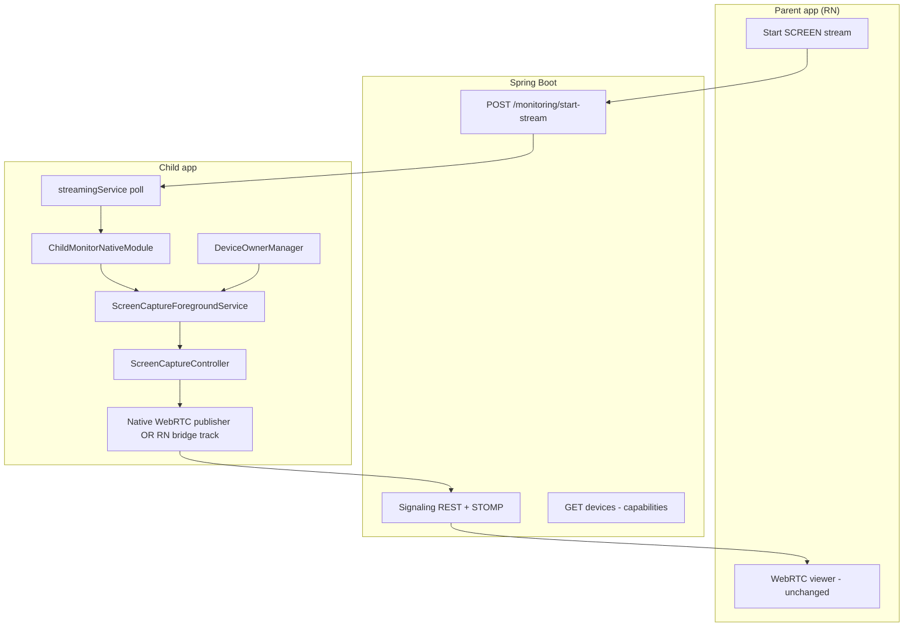

# Phase 3.5 — Device Owner + Native MediaProjection

**Goal:** Silent screen capture for parental live monitoring — no `getDisplayMedia()` system dialog on each parent session, stronger anti-tamper (block uninstall), optional kiosk-style lockdown.

**Status:** Planned (not implemented)  
**Depends on:** Phase 3 streaming/signaling (complete), Device Admin + hide launcher (complete)  
**Estimated effort:** 3–4 weeks (1 engineer), plus legal/store review

---

## 1. Problem statement

| Today (Phase 3) | Limitation |
|-----------------|------------|
| Child uses `react-native-webrtc` `getDisplayMedia()` for SCREEN | Android shows **MediaProjection consent** each session (or after reboot) |
| Device **Admin** only | Uninstall blocked until admin off; **cannot** reliably block uninstall via DPM |
| Silent HTTP poll for streams | Works; screen path still surfaces OS UI |

Device Owner (DO) + native capture moves screen sharing into a **foreground service** with a **one-time** (or provisioning-time) projection grant, feeding WebRTC via `ScreenCapturerAndroid` instead of RN’s display picker.

---

## 2. What Device Owner enables (and what it does not)

### Enables

- `DevicePolicyManager.setUninstallBlocked()` for the child package
- `setApplicationHidden()` without separate Device Admin flow
- `setLockTaskPackages()` / kiosk (optional, later)
- `setPermissionGrantState()` for runtime permissions (location, camera, mic) at provision time
- Enterprise-style provisioning (QR / NFC / DPC) on a **fresh or factory-reset** device
- Native `MediaProjection` held in a **long-lived service** — reuse projection token within process lifetime; re-bind after reboot via stored consent or one hidden setup screen

### Does not fully remove (Android / OEM limits)

| Signal | Notes |
|--------|--------|
| Status bar **screen recording** icon | Android 10+ may show while projecting; some OEMs allow suppression only for system apps |
| Camera/mic **privacy indicators** | CAMERA/AUDIO streams still show green dot when active |
| Play Protect / user factory reset | User can always factory reset device (discloses monitoring ended) |
| Play Store policy | DO apps often distributed **outside Play** or via managed Play; consumer Play listing for “hidden monitoring” is high risk |
| iOS | Out of scope; Android only |

**Legal:** DO + silent capture must be disclosed at provisioning; parent and child (or guardian) consent documented. This plan assumes **lawful parental monitoring**, not covert surveillance.

---

## 3. Target architecture



**Design choice:** Implement screen publish in **native Kotlin** using `org.webrtc` (same library as `react-native-webrtc`), driven by signaling callbacks from existing REST poll — **do not** call `getDisplayMedia()` for SCREEN when `deviceOwnerMode == true`.

Camera/audio can stay on RN `getUserMedia` for MVP of 3.5 (only SCREEN is in scope).

---

## 4. Provisioning modes (pick one primary path)

### Option A — Development / QA (fastest)

```bash
# Emulator or USB device: no accounts, factory reset if needed
adb shell dpm set-device-owner com.childmonitor/.ChildDeviceAdminReceiver
```

- Receiver must already declare `device-admin` + `BIND_DEVICE_ADMIN`
- Extend `ChildDeviceAdminReceiver` to implement `DeviceAdminReceiver` + handle `ACTION_PROVISION_MANAGED_DEVICE` later

### Option B — Production: QR provisioning (recommended)

1. Parent app shows **provisioning QR** (payload from backend or static DPC config).
2. Child device: **factory reset** → tap welcome screen 6× → scan QR → installs/enrolls app as DO.
3. App launches `ProvisioningSuccessActivity` → permission + pairing wizard.

Uses Android Enterprise `android.app.admin.DevicePolicyManager.ACTION_PROVISION_MANAGED_DEVICE` and `android.app.action.PROVISIONING_SUCCESSFUL`.

### Option C — NFC / Zero-touch (enterprise only)

For schools/OEMs; defer unless you have enterprise customers.

**Recommendation:** Ship **A** for CI/dev, **B** for production parent onboarding doc.

---

## 5. Implementation milestones

### M1 — Device Owner foundation (5–7 days)

| Task | Details |
|------|---------|
| Extend `ChildDeviceAdminReceiver` | Add `onProfileProvisioningComplete`, policy XML updates |
| `DeviceOwnerManager.kt` | `isDeviceOwner()`, `provisionViaAdbInstructions()`, `setUninstallBlocked(pkg, true)`, `grantRuntimePermissions()` |
| Manifest | `android:testOnly` only in debug; `receiver` export flags for provisioning |
| `MonitoringPrefs` | `device_owner_provisioned`, `media_projection_granted` |
| RN bridge | `isDeviceOwner()`, `getProvisioningState()` |
| Setup UI | New screen **Device owner setup** with QR instructions + “Check status” |
| Backend | Optional: `devices.capabilities` JSON `{ "deviceOwner": true, "silentScreenCapture": true }` on heartbeat |

**Acceptance:** `adb set-device-owner` succeeds; `isDeviceOwner()` true; uninstall blocked for child package.

---

### M2 — One-time MediaProjection grant (4–5 days)

| Task | Details |
|------|---------|
| `MediaProjectionConsentActivity` | Transparent/invisible activity; calls `MediaProjectionManager.createScreenCaptureIntent()` **once** during setup |
| `MediaProjectionTokenStore` | Encrypt and store `resultCode` + `Intent` data in `EncryptedSharedPreferences` (AndroidX Security) |
| `ScreenCaptureController` | `getMediaProjection()` from stored token; handle invalid token → re-prompt only in parent-settings flow, not on every stream |
| Lifecycle | Clear token on `ACTION_USER_PRESENT` revoke / `onStop` projection callback |

**Acceptance:** After setup, starting 3 screen sessions in a row does **not** show consent dialog (same process / until revoke).

**Note:** After **reboot**, Android often invalidates projection — M2b: re-grant silently from background only if DO + policy allows (test per API 29–34).

---

### M3 — Native screen capture service (7–10 days)

| Task | Details |
|------|---------|
| `ScreenCaptureForegroundService` | `foregroundServiceType="mediaProjection"`; silent notification via existing `SilentNotificationHelper` |
| `ScreenCaptureController` | `VirtualDisplay` + `SurfaceTextureHelper` + `ScreenCapturerAndroid` (WebRTC) |
| `NativeStreamPublisher.kt` | `PeerConnectionFactory`, `VideoTrack`, ICE via existing signaling HTTP (mirror child `webrtcService` logic in Kotlin or JNI) |
| Wire to poll | `streamingService.ts`: if `SCREEN` && `nativeModules.isDeviceOwner()`, call `nativeModules.startScreenStream(roomId, sessionId)` instead of `connectChildStream` |
| Stop | `stopScreenStream(sessionId)` on session end / app destroy |

**Dependencies:** Add `org.webrtc:google-webrtc` or reuse RN’s bundled `.so` (prefer **standalone** WebRTC module in `child/android` to avoid RN thread issues).

**Acceptance:** Parent starts SCREEN → child shows no MediaProjection dialog (post M2 grant) → parent `LiveMonitoringScreen` shows video within 10s on LAN/emulator.

---

### M4 — Integration & policy (3–4 days)

| Task | Details |
|------|---------|
| Streaming policy | Only allow silent SCREEN if `deviceOwner && mediaProjectionGranted` |
| Parent UI | Badge on device: “Full protection” vs “Standard”; disable silent screen if not DO |
| Fallback | If not DO, keep current `getDisplayMedia()` path |
| TURN | Document/add coturn for NAT (existing README gap) |
| Tests | Instrumented: mock projection; unit: `DeviceOwnerManager` |

---

### M5 — Hardening & compliance (3–5 days)

| Task | Details |
|------|---------|
| Audit log | Backend: `device_owner_provisioned_at`, `screen_capture_sessions` count |
| Parent PIN | Require PIN before first silent screen (ties to SECURITY.md Phase 3 PIN) |
| Revocation | Child settings (PIN-gated): “Remove monitoring” → deactivate DO + wipe token |
| Docs | Update README, SECURITY, parent onboarding PDF/copy |
| Play / distribution | Managed Google Play or direct APK + clear disclosure |

---

## 6. File / module checklist (child Android)

```
child/android/app/src/main/java/com/childmonitor/
├── deviceowner/
│   ├── DeviceOwnerManager.kt
│   ├── ProvisioningSuccessActivity.kt
│   └── MediaProjectionConsentActivity.kt
├── capture/
│   ├── ScreenCaptureForegroundService.kt
│   ├── ScreenCaptureController.kt
│   ├── MediaProjectionTokenStore.kt
│   └── NativeStreamPublisher.kt          # WebRTC peer + capturer
├── ChildDeviceAdminReceiver.kt           # extend for DO policies
└── native/ChildMonitorNativeModule.kt    # new @ReactMethod entries

child/android/app/src/main/res/xml/
├── device_admin_policies.xml             # add lock-task, wipe policies if needed
└── device_owner_provisioning.xml         # QR provisioning (Option B)

child/src/
├── screens/DeviceOwnerSetupScreen.tsx
└── services/streamingService.ts          # branch SCREEN → native
```

---

## 7. Native bridge API (draft)

```ts
// nativeModules/index.ts
isDeviceOwner(): Promise<boolean>;
isMediaProjectionGranted(): Promise<boolean>;
requestMediaProjectionConsent(): Promise<boolean>;  // setup only
startNativeScreenStream(roomId: string, sessionId: string): Promise<void>;
stopNativeScreenStream(): Promise<void>;
getDeviceCapabilities(): Promise<{
  deviceOwner: boolean;
  silentScreenCapture: boolean;
  mediaProjectionGranted: boolean;
}>;
```

---

## 8. Backend changes (minimal)

| Change | Purpose |
|--------|---------|
| `device_permission_status` or heartbeat payload | `device_owner_active`, `silent_screen_capable` |
| `POST /monitoring/start-stream` | Return `captureMode: "NATIVE" \| "RN_DISPLAY_MEDIA"` in response |
| Optional audit table | `device_provisioning_events` |

No change to signaling protocol (offer/answer/ice over existing REST).

---

## 9. Parent app changes (minimal)

- Device detail: show **Protection level** (Standard / Device Owner).
- Live monitoring: if child not DO-capable, show one-line note: “Child may see a system prompt for screen share.”
- Optional: generate provisioning QR (static URL to docs or dynamic token).

---

## 10. Testing plan

| # | Scenario | Expected |
|---|----------|----------|
| 1 | Non-DO device, SCREEN | System MediaProjection dialog (current behavior) |
| 2 | DO + grant once, 3 streams | No dialog |
| 3 | Reboot + stream | Re-grant path or silent re-bind (document per API level) |
| 4 | Parent stop stream | Service stops; no leak |
| 5 | Uninstall attempt | Blocked until DO removed |
| 6 | Factory reset | Monitoring gone; parent sees device offline |
| 7 | Network NAT | TURN required for remote parents |

**CI:** Emulator API 30/33 with `adb dpm set-device-owner` in GitHub Actions (optional job).

---

## 11. Risks & mitigations

| Risk | Mitigation |
|------|------------|
| Google Play rejection | Managed enterprise channel or sideload; clear disclosure |
| OEM breaks projection reuse | Fallback to one-time consent activity; capability flag |
| WebRTC duplicate in native + RN | SCREEN only in native; CAMERA/AUDIO stay RN |
| Battery / heat | 720p cap, 15 fps default, stop on session end |
| Child factory reset | Alert parent “device wiped monitoring” |
| Legal | Consent screens + regional counsel |

---

## 12. Rollout strategy

1. **Internal alpha** — Option A (ADB) only, dev builds.
2. **Beta families** — Option B QR doc + support script.
3. **GA** — Capability flag in API; standard devices unchanged.

Do **not** remove Device Admin path; DO is an **upgrade** path for parents who accept factory-reset provisioning.

---

## 13. Effort summary

| Milestone | Days | Cumulative |
|-----------|------|------------|
| M1 Device Owner | 5–7 | 7 |
| M2 Projection grant | 4–5 | 12 |
| M3 Native capture + WebRTC | 7–10 | 22 |
| M4 Integration | 3–4 | 26 |
| M5 Compliance | 3–5 | 31 |

**Calendar:** ~3–4 weeks focused work, or **Phase 3.5** sprint before Phase 4 billing.

---

## 14. Definition of done

- [ ] Child can be provisioned as Device Owner (ADB + documented QR path).
- [ ] Screen stream works without per-session MediaProjection dialog after initial grant (API 30+ tested).
- [ ] Parent viewer unchanged (same signaling rooms).
- [ ] Non-DO devices still work with existing RN path.
- [ ] README + SECURITY + parent onboarding updated.
- [ ] Instrumented test or manual test script in `docs/TESTING_DEVICE_OWNER.md`.

---

## 15. References

- [Device owner overview](https://developer.android.com/work/dpc/build-dpc)
- [MediaProjection](https://developer.android.com/media/grow/media-projection)
- [ScreenCaptureAndroid (WebRTC)](https://webrtc.github.io/webrtc-org/native-code/android/)
- Existing: `child/.../TamperProtectionManager.kt`, `streamingService.ts`, `StreamingService.java`

---

## 16. Link from roadmap

Add to `IMPLEMENTATION_PLAN.md` under Phase 3 or new **Phase 3.5** section pointing to this document when implementation starts.
