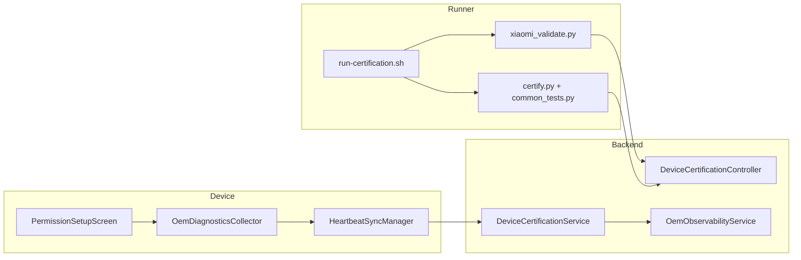

# P1-10: OEM Validation Matrix & Automated Device Certification Program

Guarantees consistent behavior of screen sharing, camera/audio monitoring, remote control, command delivery, pairing, and recovery across major Android OEMs and API levels 33–36.

---

## 1. OEM Compatibility Audit

### OEM-sensitive areas (audited)

| Area | Risk on aggressive OEMs | Implementation |
|------|-------------------------|----------------|
| **Foreground Services** | HyperOS/ColorOS kill FGS without whitelist | `MonitoringForegroundService`, `TypedStreamFgsTimeout`, Android 15 `onTimeout` |
| **Accessibility** | User can disable in Settings | `AccessibilityHealthChecker`, heartbeat `accessibilityServiceConnected` |
| **MediaProjection** | Consent lost on process death | `MediaProjectionRecoveryManager`, consent state machine |
| **Autostart** | No public API on MIUI/ColorOS | Deep-links per vendor in `OemPowerWhitelistHelper` |
| **Battery optimization** | Doze kills heartbeat/FCM | `ACTION_REQUEST_IGNORE_BATTERY_OPTIMIZATIONS` + OEM battery screens |
| **WorkManager** | Background restriction delays FALLBACK | `BootWakeChain` FAST→RECOVERY→FALLBACK |
| **AlarmManager** | Exact alarm permission denied API 31+ | Reported in `OemDiagnosticsCollector.exactAlarmsAllowed` |
| **FCM delivery** | OEM push restrictions in Doze | STOMP fallback + `validate-fcm-doze.sh` |
| **Notifications** | POST_NOTIFICATIONS API 33+ | Setup wizard + diagnostics |
| **Overlay** | Required for block screens | `Settings.canDrawOverlays` in readiness score |

### Vendor runtime support

| Vendor | Kotlin routing | Validation runner |
|--------|----------------|-------------------|
| Xiaomi / HyperOS | Full autostart + battery | `scripts/validation/xiaomi/` (16 tests) |
| Samsung One UI | Never sleeping apps intent | `certify.py` + common tests |
| Oppo ColorOS | Startup manager intent | `certify.py` |
| Vivo Funtouch | Background whitelist intent | `certify.py` |
| Realme UI | ColorOS stack intents | `certify.py` |
| OnePlus OxygenOS | Chain launch intent | `certify.py` |
| Motorola | Battery manager intent | `certify.py` |
| Pixel (AOSP) | Stock — battery optional | `certify.py` |

---

## 2. Validation Matrix

Full matrix: [`infra/oem/behavior-matrix.yaml`](../infra/oem/behavior-matrix.yaml)

**Status legend:** `supported` | `restricted` | `broken` | `requires_user_action` | `requires_workaround`

### Certification test catalog (CERT-01 … CERT-12)

| ID | Test | Automation |
|----|------|------------|
| CERT-01 | Pairing | Xiaomi: auto; others: manual pre-pair |
| CERT-02 | Heartbeat / API health | Automated |
| CERT-03 | Process kill recovery | Automated (ADB) |
| CERT-04 | Reboot recovery | Automated (Xiaomi) / manual nightly |
| CERT-05 | Force stop recovery | Automated |
| CERT-06 | Background survival | Automated (2–30 min) |
| CERT-07 | Network loss / restore | Xiaomi automated |
| CERT-08 | FCM wake / Doze | `validate-fcm-doze.sh` |
| CERT-09 | Screen sharing | Manual (parent stream) |
| CERT-10 | Audio monitoring | Manual |
| CERT-11 | Camera monitoring | Manual |
| CERT-12 | Remote control | Manual |

---

## 3. Certification Framework



**Artifacts:**
- Schema: `infra/oem/certification-schema.json`
- Unified runner: `scripts/validation/oem/run-certification.sh`
- Reports: `reports/oem-certification.json`, `reports/xiaomi-validation.html`

---

## 4. Automated Test Design

```bash
# Auto-detect OEM from connected device
./scripts/validation/oem/run-certification.sh --oem auto --serial <adb>

# Xiaomi full 16-test suite
./scripts/validation/oem/run-certification.sh --oem xiaomi

# Fast CI smoke (2m background)
CERT_FAST=1 ./scripts/validation/oem/run-certification.sh --oem samsung --fast

# Upload to backend
ADMIN_TOKEN=<jwt> DEVICE_ID=<uuid> ./scripts/validation/oem/run-certification.sh --oem auto --upload

# Chaos OEM matrix
./scripts/chaos/run-chaos-suite.sh --suite oem-matrix --device-serial <adb>
```

**Harness components:**
- `OemDiagnosticsCollector` — device-side precheck via `adb broadcast com.childmonitor.VALIDATION_DUMP`
- `common_tests.py` — kill, force-stop, background, API health
- Xiaomi framework — pairing, FCM, network, reboot (existing)

---

## 5. OEM Workarounds

| OEM | Issue | Workaround |
|-----|-------|------------|
| **Xiaomi / HyperOS** | Background kill, autostart required | Battery exempt + MIUI autostart deep-link; recents lock manual |
| **Samsung** | Sleeping apps | Device care → Battery → Never sleeping apps |
| **Oppo / Realme** | Startup manager blocks app | ColorOS autostart whitelist |
| **Vivo** | Background power manager | iManager whitelist |
| **OnePlus** | Chain launch optimization | Security → Chain launch → allow app |
| **Motorola** | Moto battery saver | Moto Actions battery screen |
| **Pixel** | Android 15 FGS 6h limit | `TypedStreamFgsTimeout` + boot chain reschedule |

Recovery strategies are invoked from `BootReceiver` on every `BOOT_COMPLETED`.

---

## 6. Device Readiness Scoring

**Client-side score (0–100)** — `OemSetupValidator.computeReadinessScore()`:

| Signal | Points |
|--------|--------|
| Paired | 10 |
| Battery exempt (or not required) | 15 |
| Autostart prompt done (or not required) | 15 |
| Accessibility enabled | 20 |
| MediaProjection active | 15 |
| FCM token present | 10 |
| OEM setup complete | 15 |

**Failure classifications:** `BATTERY_NOT_EXEMPT`, `AUTOSTART_NOT_CONFIRMED`, `ACCESSIBILITY_DISABLED`, `MEDIA_PROJECTION_NOT_ACTIVE`, `FCM_TOKEN_MISSING`

**Fleet gates:** readiness ≥ 80, no critical failure classes (see `behavior-matrix.yaml`)

**Parent visibility:** `DeviceResponse.deviceReadinessScore`, `oemSetupComplete`, `certificationStatus`

---

## 7. Monitoring Strategy

### Prometheus metrics

| Metric | Labels |
|--------|--------|
| `device.oem.heartbeat.total` | vendor, oem_setup_complete |
| `device.oem.readiness.score` | vendor |
| `device.oem.setup_incomplete.total` | vendor |
| `device.oem.failure.total` | vendor, classification |
| `device.oem.certification.total` | vendor, status |

**Dashboard:** `infra/observability/grafana/dashboards/pcp-oem-reliability.json`

### Heartbeat OEM payload

```json
{
  "oemVendor": "samsung",
  "androidSdkInt": 34,
  "deviceReadinessScore": 85,
  "oemSetupComplete": true,
  "oemDiagnostics": { "failureClassifications": [] }
}
```

---

## 8. Rollout Plan

| Phase | Duration | Deliverable |
|-------|----------|-------------|
| **1 — Foundation** | Week 1 | OEM vendor detection, diagnostics, heartbeat, matrix YAML |
| **2 — Xiaomi baseline** | Week 2 | Existing 16-test suite wired to certification ingest |
| **3 — Common runner** | Week 3 | Samsung, Oppo, Vivo, OnePlus, Motorola, Pixel common tests |
| **4 — Device farm** | Week 4–6 | API 33–36 matrix on physical devices |
| **5 — Release gate** | Week 7+ | ≥90% certification score required for GA on new OEM |

---

## 9. Support Playbook

### Triage by failure classification

| Classification | User action | Support script |
|----------------|-------------|----------------|
| `BATTERY_NOT_EXEMPT` | Settings → Battery → Don't optimize | `openBatteryOptimizationSettings()` |
| `AUTOSTART_NOT_CONFIRMED` | OEM autostart whitelist | `openOemBackgroundSettings()` |
| `ACCESSIBILITY_DISABLED` | Re-enable accessibility service | `openAccessibilitySettings()` |
| `MEDIA_PROJECTION_NOT_ACTIVE` | Re-grant screen capture | Permission setup screen |
| `FCM_TOKEN_MISSING` | Check Google Play Services, network | Re-pair if persistent |

### Diagnostics collection

```bash
adb shell am broadcast -a com.childmonitor.VALIDATION_DUMP
adb logcat -d | grep OEM_VALIDATION
./scripts/validation/oem/run-certification.sh --oem auto --fast
```

### Escalation

1. Collect `reports/oem-certification.json` + `logs/xiaomi/<run-id>/`
2. Check Grafana OEM dashboard for fleet-wide regression
3. File with OEM vendor, API level, readiness score, failure classifications

---

## 10. OEM Certification Program

### Certification levels

| Level | Criteria | Valid for |
|-------|----------|-----------|
| **Bronze** | Automated tests ≥85% pass | Beta / internal |
| **Silver** | Automated 100% + manual streams signed off | Staged rollout |
| **Gold** | 7-day farm run ≥90% on target API + OEM | GA release |

### Sign-off checklist (per OEM × API level)

- [ ] Precheck / diagnostics dump PASS
- [ ] CERT-02..08 automated PASS
- [ ] CERT-09..12 manual stream PASS
- [ ] Reboot + force-stop recovery PASS
- [ ] Battery saver ON recovery PASS
- [ ] Network handoff PASS
- [ ] Readiness score ≥ 80 sustained 24h
- [ ] Certification report ingested to backend

### Program ownership

- **Platform:** Android OEM helpers, readiness scoring
- **QA:** Device farm execution, manual stream sign-off
- **SRE:** Grafana OEM dashboard, certification metrics
- **Support:** Failure classification playbook

---

## Quick reference

| Resource | Path |
|----------|------|
| Behavior matrix | `infra/oem/behavior-matrix.yaml` |
| Certification runner | `scripts/validation/oem/run-certification.sh` |
| Xiaomi suite | `scripts/validation/xiaomi/` |
| Android OEM code | `child-app/.../oem/` |
| Backend ingest | `POST /api/v1/admin/certification/report` |
| Setup wizard | `child-app/src/screens/PermissionSetupScreen.tsx` |
