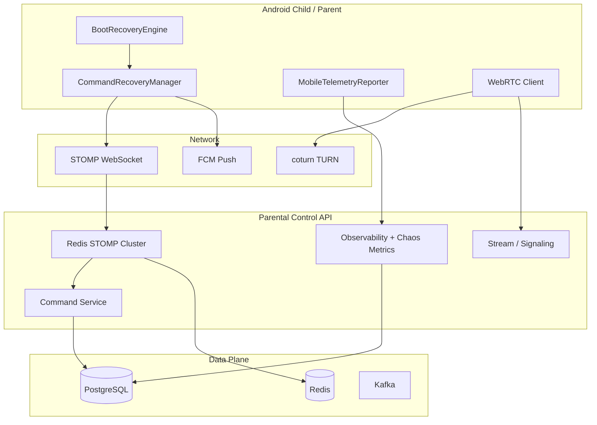
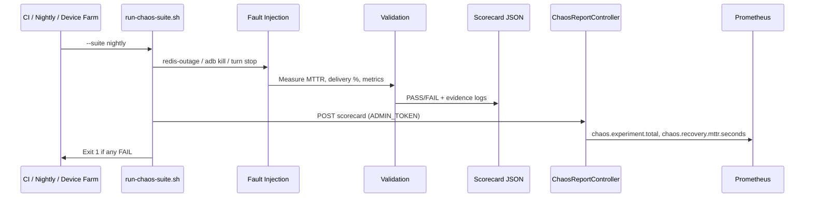

# Parental Control Platform — Chaos Engineering & Reliability Validation Framework

Principal Reliability Engineering deliverable. Assumes P0/P1 improvements are deployed: MediaProjection Recovery, Command Idempotency/Durability, Stream Teardown Fix, Boot Recovery Chain, TURN Infrastructure, STOMP Scaling, Play Integrity Hardening, Observability Platform.

---

## 1. Reliability Architecture

### Design principles

| Layer | Responsibility | Failure mode handled |
|-------|----------------|---------------------|
| **Android client** | BootRecoveryEngine, CommandRecoveryManager, FGS lifecycle | Process death, OEM kill, projection loss |
| **Transport** | STOMP + FCM dual-path, offline command buffer | Network partition, FCM outage |
| **Backend** | Idempotent commands, Redis cluster fan-out, connection pools | Pod crash, Redis/Kafka degradation |
| **Streaming** | Ephemeral TURN creds, ICE reporting, session replacement | TURN outage, ICE failure, mid-stream disconnect |
| **Observability** | Correlation IDs, Prometheus metrics, mobile telemetry | MTTR measurement, SLO burn detection |

### System context



### Recovery chains (implemented)

1. **Boot recovery:** `BOOT_RECEIVED → FAST → RECOVERY → FALLBACK` with WorkManager scheduling and FCM wake.
2. **Command durability:** Persist → deliver via STOMP → FCM fallback → client replay on reconnect.
3. **Stream teardown:** Coordinator ends session on parent/child disconnect; FGS released idempotently.
4. **MediaProjection:** Heartbeat clears stale grant; parent alert on loss.
5. **STOMP scaling:** Redis pub/sub fan-out across pods; reconnect on disconnect.

---

## 2. Chaos Framework Design

### Components

| Component | Path | Role |
|-----------|------|------|
| Test matrix | `infra/chaos/test-matrix.yaml` | Scenario catalog, pass criteria, MTTR targets |
| Scorecard schema | `infra/chaos/scorecard-schema.json` | Structured run results |
| Unified runner | `scripts/chaos/run-chaos-suite.sh` | Suite orchestration |
| Scenario scripts | `scripts/chaos/scenarios/**` | Fault injection + validation |
| Backend ingest | `POST /api/v1/admin/chaos/scorecard` | Prometheus correlation |
| Grafana dashboard | `infra/observability/grafana/dashboards/pcp-reliability-chaos.json` | Reliability visualization |

### Chaos workflow



### Suite tiers

| Suite | Trigger | Scope |
|-------|---------|-------|
| `ci-backend` | PR + nightly cron | Redis, Postgres, command burst (no device) |
| `nightly` | Scheduled + manual | Backend + network + streaming + Android (if serial set) |
| `oem-matrix` | Pre-release | Xiaomi validation framework + OEM battery tests |

---

## 3. Test Matrix

Full catalog: [`infra/chaos/test-matrix.yaml`](../infra/chaos/test-matrix.yaml)

### Android (AND-01 … AND-08)

| ID | Fault | Recovery expectation | MTTR | Automation |
|----|-------|---------------------|------|------------|
| AND-01 | Process kill (SIGKILL) | CommandRecoveryManager replay | ≤60s | `android/process-kill.sh` |
| AND-02 | Force stop | BootRecovery FAST + WorkManager | ≤120s | `android/force-stop.sh` |
| AND-03 | Reboot | BootWakeChain FAST→RECOVERY→FALLBACK | ≤600s | `android/reboot-recovery.sh` |
| AND-04 | OEM battery optimization | FCM wake + WM poll | ≤300s | Xiaomi validation |
| AND-05 | Accessibility restart | Reconnect telemetry | ≤60s | Manual |
| AND-06 | MediaProjection loss | Stale flag cleared, alert | ≤30s | Instrumented tests |
| AND-07 | FGS timeout (Android 15) | Boot chain reschedule, teardown | — | `docs/android15-fgs-test-plan.md` |
| AND-08 | WorkManager delay | FALLBACK within 15m | ≤900s | `android/workmanager-delay.sh` |

### Networking (NET-01 … NET-06)

| ID | Fault | Pass criteria | Automation |
|----|-------|---------------|------------|
| NET-01 | Airplane mode | Recovery ≤120s on restore | `network/airplane-mode.sh` |
| NET-02 | API unreachable | Commands buffered, ≥95% delivery | `network/api-unreachable.sh` |
| NET-03 | DNS failure | No crash, backoff retry | Manual |
| NET-04 | WiFi ↔ mobile handoff | STOMP ≤60s, ICE restart | Xiaomi validation |
| NET-05 | TURN outage | ICE failure reported, metric ↑ | `streaming/turn-outage.sh` |
| NET-06 | STOMP disconnect | Command after reconnect | `stomp-multi-pod-smoke.sh` |

### Backend (BE-01 … BE-07)

| ID | Fault | Pass criteria | Automation |
|----|-------|---------------|------------|
| BE-01 | Pod crash | Readiness ≤120s | `backend/pod-kill.sh` |
| BE-02 | Rolling deploy | API available throughout | `backend/rolling-deploy.sh` |
| BE-03 | Redis outage | Graceful errors, recovery ≤60s | `backend/redis-outage.sh` |
| BE-04 | PostgreSQL restart | Commands persisted, API ≤90s | `backend/postgres-restart.sh` |
| BE-05 | Kafka outage | Core API healthy | `backend/kafka-outage.sh` |
| BE-06 | FCM outage | STOMP-only delivery | Integration test |
| BE-07 | 100 ops during Redis fault | ≥90% success | `command-burst-redis-outage.sh` |

### Streaming (STR-01 … STR-05)

| ID | Fault | Pass criteria | Automation |
|----|-------|---------------|------------|
| STR-01 | ICE failure | Failure reported to metrics | `turn-outage.sh` |
| STR-02 | Session replacement | Single active session | Integration test |
| STR-03 | Parent disconnect | Teardown ≤30s | Manual |
| STR-04 | Child disconnect | Session FAILED | `force-stop.sh` |
| STR-05 | Mid-stream network change | No orphan FGS | `airplane-mode.sh` |

### Burst validation (production gate)

| Target | Count | Scenario | Pass |
|--------|-------|----------|------|
| Commands during failure | 100 | BE-03 + paired tokens | ≥95% delivered, p95 lag ≤120s |
| Stream startups during failure | 100 | NET-05 + `stream-burst-turn-outage.sh` | ≥90% config/health success |
| Reboot recovery | 1 | AND-03 | ONLINE ≤10m |
| Multi-pod failover | 1 | NET-06 | Command after reconnect |
| Android 15 FGS timeout | 1 | AND-07 | Boot chain + teardown complete |

---

## 4. Automation Strategy

### Android automation

- **ADB scripts** under `scripts/chaos/scenarios/android/` for process kill, force-stop, reboot, WorkManager delay.
- **OEM matrix** via `scripts/validation/xiaomi/` (battery, handoff, background restrictions).
- **Device farm:** Firebase Test Lab / internal farm with `DEVICE_SERIAL`, `DEVICE_ID`, `PARENT_TOKEN` env vars.
- **Instrumented tests:** MediaProjection recovery, command idempotency (child-app/androidTest).

### Backend automation

- **Podman compose faults:** `compose stop/start` for Redis, Postgres, Kafka, backend, coturn.
- **Kubernetes faults:** `kubectl delete pod`, `kubectl rollout restart` (staging/prod-shadow).
- **Integration tests:** `ChaosReliabilityIntegrationTest`, command idempotency, STOMP cluster tests.

### Network fault injection

- Airplane mode via `adb shell cmd connectivity airplane-mode`.
- API pause via `podman pause pcp-backend`.
- TURN outage via coturn container stop.
- **Advanced (staging):** toxiproxy for packet loss, DNS override via `/etc/hosts` on test harness.

### Kubernetes fault injection

- Pod kill + rolling deploy scripts (require `kubectl` + cluster context).
- Helm values: `replicaCount: 2+` for zero-downtime validation during BE-02.

---

## 5. Metrics & KPIs

### Chaos telemetry (backend)

| Metric | Labels | Use |
|--------|--------|-----|
| `chaos.experiment.total` | scenario, status | Run pass/fail rate |
| `chaos.recovery.total` | domain, success | Recovery success ratio |
| `chaos.recovery.mttr.seconds` | — | MTTR distribution (p50/p95) |
| `chaos.recovery.duration.seconds` | scenario | Per-scenario timer |

### Business reliability metrics

| Metric | SLO target |
|--------|------------|
| `command.executed.total` / `command.failure.total` | ≥99% delivery (24h) |
| `stream.start.total` / `stream.failure.total` | ≥95% startup success |
| `device.boot.recovery.total{success=true}` | ≥98% boot recovery |
| `device.boot.phase.total{phase,success}` | FAST ≤120s, FALLBACK ≤900s |
| `stomp.cluster.messages.total` | No message loss during pod failover |

### Reliability scorecard (per run)

```json
{
  "summary": {
    "reliabilityScore": 95.0,
    "passed": 19,
    "failed": 1,
    "mttrSecondsP50": 45,
    "mttrSecondsP95": 120
  }
}
```

**Score formula:** `(passed / (passed + failed)) × 100` — skipped scenarios excluded from numerator/denominator.

### Alert validation

- **BootRecoverySLOBurnRate** — fires when boot recovery success drops below SLO.
- Chaos nightly failure → CI artifact + optional PagerDuty via Alertmanager route `chaos-nightly`.
- Post-chaos: verify alerts **resolve** within MTTR window (alert validation runbook).

---

## 6. CI/CD Integration

### Pipelines

| Stage | Workflow | Action |
|-------|----------|--------|
| PR | `backend-ci.yml` | `ChaosReliabilityIntegrationTest` |
| Nightly 04:00 UTC | `chaos-nightly.yml` | Podman stack + `ci-backend` suite |
| Pre-release | Manual dispatch | `--suite nightly` + OEM matrix |
| Prod-shadow | Weekly | K8s fault scripts against staging |

### Local execution

```bash
./scripts/dev/compose.sh up -d postgres redis backend coturn
chmod +x scripts/chaos/run-chaos-suite.sh scripts/chaos/scenarios/**/*.sh
./scripts/chaos/run-chaos-suite.sh --suite ci-backend

# With scorecard ingest
export ADMIN_TOKEN=<admin-jwt>
./scripts/chaos/run-chaos-suite.sh --suite nightly --device-serial <serial>
```

### Artifacts

- Scorecard JSON: `artifacts/chaos/<timestamp>/scorecard.json`
- Per-scenario logs: `artifacts/chaos/<timestamp>/<SCENARIO-ID>.log`
- GitHub Actions upload: `chaos-scorecard` artifact

---

## 7. Rollout Plan

| Phase | Duration | Activities | Exit criteria |
|-------|----------|------------|---------------|
| **0 — Foundation** | Week 1 | Matrix, runner, ci-backend suite, integration test | CI green, scorecard schema validated |
| **1 — Backend chaos** | Week 2 | Redis/PG/Kafka/pod faults in staging | MTTR baselines recorded |
| **2 — Device farm** | Week 3–4 | AND-01..03 nightly on 3 OEMs | ≥90% reliability score 7-day |
| **3 — Streaming chaos** | Week 5 | TURN outage + 100 stream burst with tokens | Stream SLO met |
| **4 — Production shadow** | Week 6+ | Read-only chaos in prod-shadow cluster | No customer impact, alerts validated |
| **5 — Game days** | Quarterly | Combined multi-fault scenarios | Runbook updates, MTTR improvement |

---

## 8. Reliability Scorecard

### Template (latest run)

| Domain | Scenarios | Pass | Fail | Skip | Avg MTTR |
|--------|-----------|------|------|------|----------|
| Android | 8 | — | — | — | — |
| Networking | 6 | — | — | — | — |
| Backend | 7 | 3* | 0* | 0* | ~45s* |
| Streaming | 5 | — | — | — | — |
| **Total** | **26** | — | — | — | — |

*\* ci-backend suite subset; full matrix requires nightly + device farm.*

### Pass/fail gates (release)

| Gate | Threshold |
|------|-----------|
| Overall reliability score | ≥95% |
| P0 scenarios (AND-01, AND-03, BE-03, BE-04, NET-06) | 100% pass |
| Command burst (100) | ≥95% delivery |
| Stream burst (100) | ≥90% success or 100% failure reported |
| Boot recovery | ONLINE ≤10m |
| No unrecovered alerts post-run | 0 firing > MTTR |

---

## 9. Operational Procedures

### Pre-chaos checklist

1. Confirm staging/isolated environment (never prod without shadow mode).
2. Notify `#sre-oncall` for nightly; game days require change ticket.
3. Verify observability stack: Prometheus, Grafana dashboard `PCP Reliability & Chaos`.
4. Export tokens: `ADMIN_TOKEN`, `PARENT_TOKEN`, `DEVICE_ID`, `DEVICE_SERIAL`.

### During execution

1. Run `./scripts/chaos/run-chaos-suite.sh --suite <name>`.
2. Monitor Grafana: `chaos.experiment.total`, command/stream counters.
3. Collect evidence logs from `artifacts/chaos/`.

### Post-chaos

1. Review scorecard; file issues for FAIL scenarios.
2. Confirm alerts fired and resolved (alert validation).
3. Upload scorecard if not auto-ingested: `curl -X POST .../admin/chaos/scorecard`.
4. Update MTTR baselines in `infra/observability/SLO.md`.

### Rollback

- All compose faults: `compose start <service>` restores state.
- Android: `adb shell cmd appops set <pkg> RUN_IN_BACKGROUND allow`.
- K8s: `kubectl rollout undo deployment/parental-control-api`.

---

## 10. Production Readiness Impact

| P0/P1 capability | Chaos scenarios validating it | PRR impact |
|------------------|------------------------------|------------|
| MediaProjection Recovery | AND-06, STR-05 | Reduces false “online” during projection loss |
| Command Idempotency/Durability | BE-03, BE-07, NET-02 | Proves no duplicate/missing commands under fault |
| Stream Teardown Fix | STR-03, STR-04, AND-07 | Prevents orphan FGS and zombie sessions |
| Boot Recovery Chain | AND-02, AND-03, AND-08 | Validates ONLINE within SLO after reboot/OEM kill |
| TURN Infrastructure | NET-05, STR-01, stream burst | Ephemeral creds + graceful ICE failure |
| STOMP Scaling | NET-06, BE-01, BE-02 | Multi-pod command delivery |
| Play Integrity | AND-04 (OEM) | Device trust under background restriction |
| Observability | All scenarios | MTTR measurable; SLO burn alerts |

### Residual risks (tracked)

| Risk | Mitigation | Target |
|------|------------|--------|
| Full 100-command burst needs paired device | Extend `command-burst-redis-outage.sh` with API command POST | Phase 3 |
| Mobile telemetry upload has no offline queue | Retry queue in `MobileTelemetryReporter` | P2 |
| DNS/packet-loss faults manual | toxiproxy in staging | Phase 4 |
| FCM real outage | Mock + STOMP-only integration test | BE-06 |

### PRR sign-off criteria

- [ ] ci-backend suite green 7 consecutive nights
- [ ] OEM matrix ≥90% on Xiaomi, Samsung, Pixel
- [ ] 100 command + 100 stream burst passed in staging
- [ ] Reboot recovery (AND-03) passed on Android 15 device
- [ ] Multi-pod STOMP smoke passed
- [ ] Grafana reliability dashboard + BootRecoverySLOBurnRate alert verified
- [ ] Runbooks updated in `infra/observability/RUNBOOKS.md`

---

## Quick reference

| Resource | Location |
|----------|----------|
| Test matrix | `infra/chaos/test-matrix.yaml` |
| Runner | `scripts/chaos/run-chaos-suite.sh` |
| README | `infra/chaos/README.md` |
| Dashboard | `infra/observability/grafana/dashboards/pcp-reliability-chaos.json` |
| Nightly CI | `.github/workflows/chaos-nightly.yml` |
| Integration test | `backend/.../ChaosReliabilityIntegrationTest.java` |
