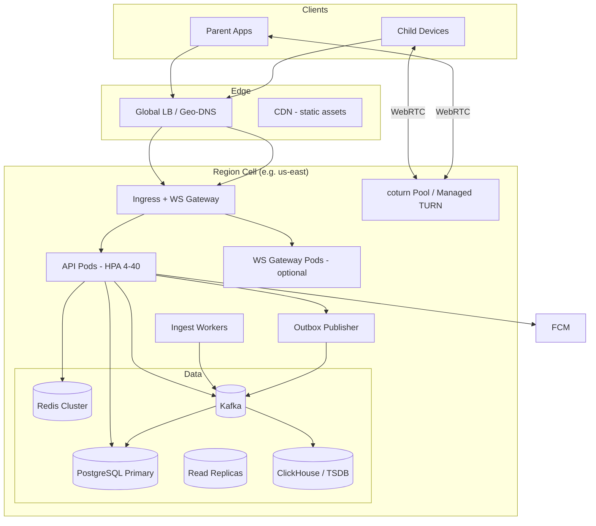
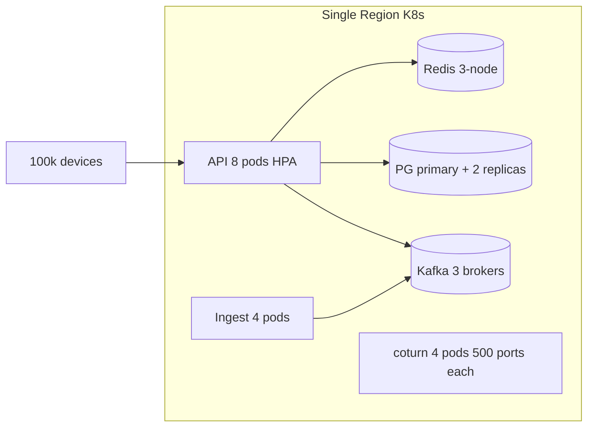
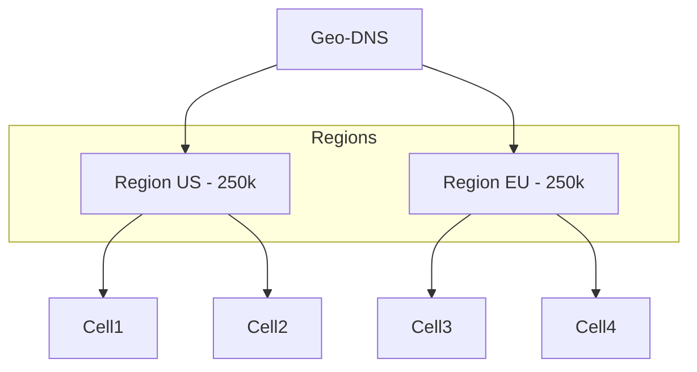
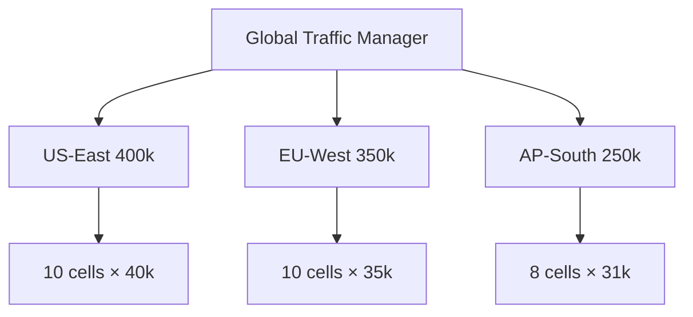
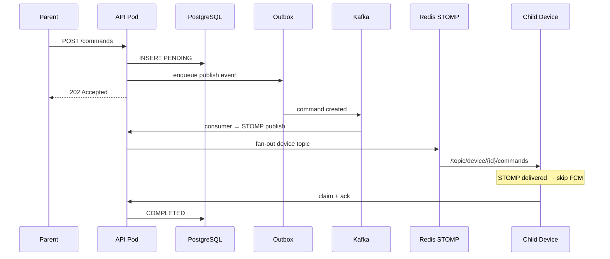

# Scalability Architecture — Parental Control Platform

**Assumption:** All P0/P1 initiatives completed (STOMP ownership, WebRTC lifecycle, Android 16, OEM certification, chaos framework, command durability, TURN infra).

**Target scale tiers:** 100k · 500k · 1M+ active paired devices  
**SLO anchors:** Command 99.5% / 120s · Stream 95% / 30s · Heartbeat 99% / 3min · API 99.9%

---

## 1. Current State Assessment

### Architecture today

| Layer | Implementation | Scale posture |
|-------|----------------|---------------|
| **API** | Spring Boot modular monolith, 2 Helm replicas | Horizontally scalable REST; WS via Redis fan-out |
| **Realtime** | STOMP `/ws-native`; `STOMP_CLUSTER_MODE=redis` | Multi-pod with pub/sub bridge |
| **Commands** | PostgreSQL `device_commands` + STOMP + FCM + 3s poll | Durable, idempotent; sync publish |
| **Presence** | `devices.last_seen_at`; 10min offline threshold | Row-per-device; no Redis presence cache |
| **Heartbeats** | `POST /device/heartbeat` → UPDATE `devices` | ~1 write/device/interval |
| **Streaming** | PG sessions + PG signaling + STOMP + coturn | Media P2P; signaling DB-bound |
| **Monitoring ingest** | Sync PG append + optional Kafka (log-only consumer) | Kafka not on critical path |
| **Tenancy** | `parent_profile_id` row scoping | Household model; no org hierarchy |
| **Multi-region** | None | Single-region deployment |

### Device lifecycle (current)

```
Pairing → device row + JWT + FCM token
Heartbeat (60–180s typical) → UPDATE devices + STOMP status + optional Kafka
Commands → INSERT PENDING → STOMP + FCM → claim → execute → ack
Streams → session row → stream-request STOMP + FCM → WebRTC + signaling rows
```

### Strengths (post-P0/P1)

- Command idempotency, stale reclaim, execution fingerprint
- Native-first STOMP on child (single connection)
- Redis STOMP cluster for API horizontal scale
- Burst FGS + WorkManager recovery (Android 15/16)
- ICE restart + session ownership (P1-7)
- Chaos/reliability framework with SLO definitions
- coturn HPA (2–6 replicas)

### Current comfortable capacity

| Dimension | Estimate | Hard limit |
|-----------|----------|------------|
| Paired devices | 5k–20k | PG write rate + fleet gauge `findAll()` |
| API pods | 2–8 | Redis fan-out + duplicate schedulers |
| Concurrent WS/device | ~2k–10k/pod | JVM heap, STOMP threads (4–8) |
| Concurrent TURN streams | ~240 cluster-wide | 41 relay ports × 6 coturn pods |
| Command burst | Hundreds/sec | PG + per-command STOMP+FCM |

**Scalability readiness (current): 42/100**

---

## 2. Bottleneck Analysis

### Current bottlenecks

| ID | Component | Symptom at scale | Root cause |
|----|-----------|------------------|------------|
| B1 | `DeviceHealthObservabilityService` | API CPU ↑ linearly with fleet | `findAll()` every 60s **per replica** |
| B2 | Heartbeat path | PG write QPS = devices / interval | Synchronous UPDATE + STOMP per heartbeat |
| B3 | Redis STOMP cluster | Latency spikes under broadcast | Single channel `pcp:stomp:cluster`; all pods get all messages |
| B4 | STOMP thread pools | WS disconnect storms | core=4, max=8, queue=256 |
| B5 | Signaling PG | Stream start latency | Row per SDP/ICE; poll + last-50 scan |
| B6 | coturn ports | Stream cap ~40/pod | `relayMinPort`–`relayMaxPort` = 41 |
| B7 | Kafka consumer | No ingest offload | Consumer logs only; API still sync-writes |
| B8 | Monitoring tables | Storage + query cost | No partitioning/TTL on `notification_logs`, `location_history`, etc. |
| B9 | Schedulers | Duplicate work N×pods | Presence, signaling cleanup, gauges on every replica |
| B10 | FCM cost + rate | Wake storms | Per-command FCM when STOMP already delivered |

### Future bottlenecks (100k+)

| ID | Trigger | Impact |
|----|---------|--------|
| F1 | 100k heartbeats / 60s | ~1,700 writes/s to `devices` — PG hot row |
| F2 | 1% concurrent streams (1k @ 100k) | Signaling QPS + TURN ports exceed coturn fleet |
| F3 | Policy broadcast | STOMP fan-out to 100k topics impossible from single publish |
| F4 | Multi-region | `last_seen_at` and session affinity break without regional cells |
| F5 | Tenant isolation audit | `parent_profile_id` filter on every query — index pressure |
| F6 | Cross-region TURN | UDP latency + relay routing without geo-DNS |

---

## 3. Target Architecture

### Design principles

1. **Cellular scaling** — shard by `region + tenant_bucket` (default 10k devices/cell)
2. **Async ingest** — heartbeats and monitoring logs via Kafka → workers → TSDB/PG partition
3. **Presence in Redis** — heartbeat updates Redis; PG snapshot every N minutes
4. **Dedicated realtime plane** — RabbitMQ STOMP relay or dedicated WS gateway at 500k+
5. **Signaling hot path in Redis** — PG archive async; REST poll reads Redis sorted sets
6. **TURN as managed pool** — Cloudflare Calls / Twilio / self-hosted with 10k+ ports per node
7. **Command path unchanged logically** — PG source of truth; add outbox + regional routing

### Target logical architecture



---

## 4. Capacity Planning

### Assumptions

| Parameter | Value |
|-----------|-------|
| Active paired devices | D |
| Heartbeat interval | 90s average |
| Online fraction | 35% |
| Concurrent stream rate | 0.5% of D (peak) |
| Commands per device per day | 12 |
| Signaling messages per stream | ~40 (offer/answer/ICE) |
| Avg monitoring events per device per day | 200 |

### Heartbeat load

| Scale | Devices | Heartbeat QPS | PG writes/s | Redis SET/s |
|-------|---------|---------------|-------------|-------------|
| 100k | 100,000 | 1,111 | 1,111 → **async** 200/s batched | 1,111 |
| 500k | 500,000 | 5,556 | **requires async ingest** | 5,556 |
| 1M | 1,000,000 | 11,111 | **cell sharding mandatory** | 11,111 |

**Mitigation:** Accept heartbeat → Kafka → batch UPSERT every 5s; Redis `presence:{deviceId}` TTL 300s; PG flush every 5–15 min or on state change.

### Command load

| Scale | Commands/day | Avg QPS | Peak QPS (3×) |
|-------|--------------|---------|---------------|
| 100k | 1.2M | 14 | 42 |
| 500k | 6M | 69 | 207 |
| 1M | 12M | 139 | 417 |

PostgreSQL handles this with proper indexing (`device_id`, `status`) and connection pooling (PgBouncer). Bottleneck is STOMP+FCM fan-out, not PG.

### Streaming / TURN

| Scale | Peak concurrent streams | TURN ports needed (80% relayed) | coturn pods @ 500 ports |
|-------|-------------------------|----------------------------------|------------------------|
| 100k | 500 | 400 | 1–2 |
| 500k | 2,500 | 2,000 | 4–5 |
| 1M | 5,000 | 4,000 | 8–10 |

**Current:** 41 ports × 6 = 246 max → **must expand port range or use managed TURN** before 100k.

### API / WebSocket

| Scale | WS connections (35% online) | API pods @ 5k WS each | Memory |
|-------|----------------------------|------------------------|--------|
| 100k | 35,000 | 7–10 | ~7 GB WS + API |
| 500k | 175,000 | 35–40 | Dedicated WS tier |
| 1M | 350,000 | 70+ or regional cells | WS gateway service |

### Signaling

| Scale | Peak signaling writes/s (500 streams × 40 msg / 30s) | Storage |
|-------|------------------------------------------------------|---------|
| 100k | ~667 | Redis primary; PG archive |
| 500k | ~3,333 | Redis cluster |
| 1M | ~6,667 | Regional Redis + short TTL |

---

## 5. Infrastructure Design

### 100k-device architecture



| Component | Spec |
|-----------|------|
| API | 8 pods, 1 CPU / 2Gi, HPA on CPU + WS connections |
| PostgreSQL | db.r6g.xlarge or 4 vCPU / 16GB; PgBouncer |
| Redis | 3-shard cluster, 8GB each |
| Kafka | 3 brokers, 3 partitions → 12 for ingest |
| coturn | 4 replicas, ports 49152–50152 (1000 ports) |
| FCM | Batched wake; suppress if STOMP ack within 5s |

### 500k-device architecture



| Component | Spec |
|-----------|------|
| Cells | 5 × 100k cells (50k/device cell optional) |
| API | 15–20 pods/region |
| WS Gateway | Dedicated 10 pods (STOMP relay via RabbitMQ) |
| PostgreSQL | Primary per region + read replicas; **no cross-region writes** |
| ClickHouse | Monitoring logs, 90-day retention |
| TURN | Managed provider or 10-node coturn pool per region |

### 1M-device architecture



| Component | Spec |
|-----------|------|
| Control plane | Global device registry (device → region routing) |
| Data plane | Regional autonomous stacks |
| DR | Active-passive secondary per region (RPO 15m, RTO 1h) |
| Kafka | MirrorMaker 2 cross-region for analytics only |
| TURN | Geo-routed managed TURN (Cloudflare / Twilio) |
| Cost focus | Spot ingest workers; reserved PG; TURN egress optimization |

### Command delivery sequence (target)



---

## 6. Cost Analysis (monthly estimates, AWS-equivalent)

### 100k devices

| Item | Config | Est. USD/mo |
|------|--------|-------------|
| EKS / K8s | 8 API + 4 workers | $1,200 |
| PostgreSQL | RDS r6g.xlarge + replicas | $800 |
| Redis | ElastiCache r6g.large × 3 | $450 |
| Kafka | MSK 3× kafka.m5.large | $600 |
| TURN | 4× c5n.large + egress 20TB | $2,500–4,000 |
| FCM | 12M wakes/mo (optimized) | $50–200 |
| Observability | Grafana Cloud / self-host | $300 |
| **Total** | | **$6k–8k** |

### 500k devices

| Item | Est. USD/mo |
|------|-------------|
| Compute (2 regions) | $8,000 |
| PostgreSQL (2 regions) | $4,000 |
| Redis + Kafka | $3,500 |
| TURN (managed, 2 regions) | $12,000–18,000 |
| FCM | $200–800 |
| **Total** | **$28k–35k** |

### 1M devices

| Item | Est. USD/mo |
|------|-------------|
| Multi-region stack | $18,000 |
| Data stores | $10,000 |
| TURN (managed, geo) | $25,000–40,000 |
| FCM + storage | $2,000 |
| **Total** | **$55k–70k** |

### Cost optimization levers

1. **TURN:** P2P-first ICE; short sessions; managed TURN volume discounts; regional relay
2. **FCM:** Suppress when STOMP delivered; batch policy updates
3. **DB:** Partition monitoring tables; ClickHouse for logs; archive to S3 Glacier
4. **Kafka:** Tiered storage; reduce retention on telemetry topics
5. **API:** Spot for ingest workers; HPA scale-to-zero on dev/staging cells
6. **Signaling:** Redis TTL 1h vs PG row per message

---

## 7. Migration Plan

### Phase 0 — Quick wins (0–3 months, supports 20k→50k)

| # | Change | Effort |
|---|--------|--------|
| 1 | Remove `findAll()` fleet gauges → incremental counters / sampling | S |
| 2 | API HPA in Helm (CPU + custom WS metric) | S |
| 3 | Expand coturn `relayMaxPort` to 50152 (1000 ports) | S |
| 4 | Leader-elected schedulers (ShedLock) | S |
| 5 | FCM suppress when device STOMP connected (Redis flag) | M |
| 6 | STOMP thread pool tuning + backpressure metrics | S |

### Phase 1 — 100k ready (3–6 months)

| # | Change | Effort |
|---|--------|--------|
| 7 | Heartbeat → Kafka → batch PG + Redis presence | L |
| 8 | Signaling hot path in Redis; PG async archive | L |
| 9 | Real Kafka consumers for monitoring ingest → ClickHouse | M |
| 10 | PgBouncer + read replicas for parent dashboards | M |
| 11 | RabbitMQ STOMP relay OR dedicated WS gateway | L |
| 12 | Device routing metadata (`home_region`) | M |

### Phase 2 — 500k ready (6–12 months)

| # | Change | Effort |
|---|--------|--------|
| 13 | Regional cells (Geo-DNS) | XL |
| 14 | Tenant buckets + connection limits | L |
| 15 | Managed TURN migration | M |
| 16 | Command outbox + idempotent consumers | M |
| 17 | Monitoring table partitioning (monthly) | M |

### Phase 3 — 1M+ (12–18 months)

| # | Change | Effort |
|---|--------|--------|
| 18 | Global device registry service | XL |
| 19 | Active-passive DR per region | L |
| 20 | Service extraction (streaming/signaling microservice) | XL |
| 21 | Org/SaaS multi-tenancy schema | XL |

---

## 8. Multi-Region Strategy

### Recommended: **Regional cells + global control plane**

| Pattern | Use |
|---------|-----|
| **Active-active (regional)** | US, EU, AP — devices pinned to home region at pairing |
| **Active-passive DR** | Warm standby PG replica in adjacent region |
| **Global routing** | Geo-DNS on `api.{region}.pcp.com`; device JWT includes `region` claim |
| **Cross-region** | Parents travel → read replica routing; streams stay in device home region |

### Data residency

- Device telemetry, commands, sessions: **region-local PG**
- Billing/parent account: global PG or primary region with GDPR export
- Analytics: Kafka MirrorMaker → central ClickHouse (aggregated only)

### DR targets

| Metric | Target |
|--------|--------|
| RPO | 15 minutes (PG WAL + cross-AZ) |
| RTO | 60 minutes (Helm failover to DR cell) |
| STOMP | Clients reconnect; Redis cluster per region |

---

## 9. Operational Model

### Scaling milestones

| Milestone | Devices | Gate criteria |
|-----------|---------|---------------|
| M1 | 20k | API HPA live; no `findAll()` gauges; chaos CI green |
| M2 | 100k | Async heartbeat; Redis signaling; TURN port expansion |
| M3 | 250k | First second region live |
| M4 | 500k | WS gateway; ClickHouse ingest; managed TURN |
| M5 | 1M | Global registry; 3 regions; DR tested quarterly |

### Team structure (at 500k+)

| Team | Ownership |
|------|-----------|
| **Platform** | K8s, PG, Redis, Kafka, multi-region |
| **Realtime** | STOMP, FCM, command delivery SLO |
| **Media** | TURN, signaling, WebRTC SLO |
| **Device** | Android/iOS reliability, OEM |
| **SRE** | SLOs, chaos, incident response |

### Operational requirements

- 24/7 paging for command delivery + API availability burn rates
- Weekly game days (chaos suite `nightly` + manual stream tests)
- Per-region capacity dashboards: WS connections, TURN port utilization, heartbeat lag
- Runbook: Redis STOMP outage, PG failover, coturn exhaustion, regional drain

---

## 10. Scalability Readiness Score

| Dimension | Current | Post Phase 0 | Post Phase 1 (100k) | Post Phase 2 (500k) |
|-----------|---------|--------------|----------------------|---------------------|
| Command delivery | 75 | 80 | 90 | 95 |
| Heartbeat / presence | 40 | 55 | 85 | 90 |
| Streaming / TURN | 35 | 50 | 75 | 85 |
| Realtime (STOMP) | 55 | 70 | 85 | 90 |
| Data layer (PG) | 50 | 60 | 80 | 90 |
| Multi-tenancy | 45 | 45 | 55 | 75 |
| Multi-region | 10 | 15 | 40 | 80 |
| Cost efficiency | 50 | 60 | 70 | 75 |
| **Overall** | **42** | **55** | **78** | **88** |

**1M+ overall target:** 92/100 after Phase 3 (global registry, 3 regions, managed TURN, service boundaries).

---

## Appendix A — Sharding strategy

```
shard_key = hash(device_id) % num_cells
cell_id   = region + "_" + shard_key
```

- **Devices, commands, sessions:** co-locate in cell PG
- **Parents:** global table with `default_region`
- **Signaling:** Redis key `sig:{room_id}` in device's cell

## Appendix B — Multi-tenancy evolution

| Stage | Model |
|-------|-------|
| Now | `parent_profile_id` FK |
| 100k | `tenant_id` on all tables + RLS policies |
| 500k | Org entity; sub-parents; device groups |
| 1M | Dedicated cells for enterprise tenants |

## Appendix C — Regression checklist per milestone

- [ ] 100-command burst &lt; 120s p99 ack (chaos BE-02)
- [ ] 2-pod STOMP delivery (stomp-multi-pod-smoke)
- [ ] Stream start p95 &lt; 30s under 1% concurrent load
- [ ] Heartbeat freshness &lt; 180s for 99% fleet
- [ ] TURN port exhaustion alert before 80% utilization
- [ ] Regional failover drill quarterly

---

*Document version: 1.0 · Aligned with codebase state post P0/P1 completion*
