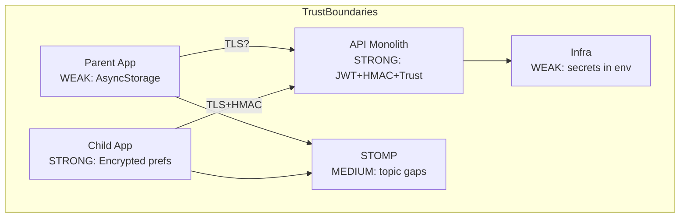
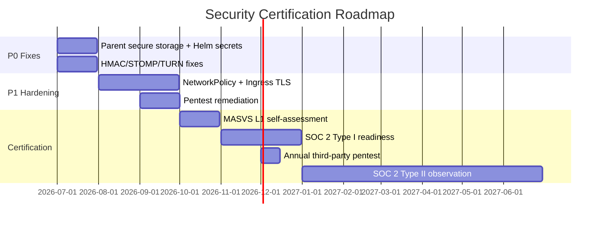

# Adversarial Security Review — Parental Control Platform

**Assumptions:** P0/P1 fixes, Android 16 migration, and 100k scalability architecture completed.  
**Methodology:** Code audit, threat modeling (STRIDE), attack trees, OWASP Mobile/API Top 10, MASVS L1/L2 mapping, red-team kill chains.  
**Scope:** Parent app, child app, backend, infrastructure, streaming, device trust.

---

## 1. Threat Model

### Assets

| Asset | Sensitivity | Impact if compromised |
|-------|-------------|------------------------|
| Parent account (JWT) | Critical | Full fleet control, stream viewing, remote gestures |
| Device JWT + HMAC key | Critical | Spoof heartbeats, inject signaling, claim commands |
| Media streams (WebRTC) | Critical | Live screen/camera/audio surveillance |
| Child location / usage / notifications | High | GDPR/COPPA violation, stalking |
| Pairing codes | High | Device hijack to attacker parent account |
| TURN credentials | Medium | Relay abuse, traffic amplification |
| Accessibility / Device Owner | Critical | Bypass app blocking, uninstall prevention |

### Threat actors

| Actor | Capability | Goal |
|-------|------------|------|
| **Malicious child (teen)** | Root, Frida, APK patch, disable services | Disable monitoring, fake online status |
| **External attacker** | Network MITM, credential theft, API abuse | Parent account takeover, stream intercept |
| **Malicious parent** | Legitimate account | Stalk non-child, abuse remote control |
| **Supply chain** | Compromised dependency | Backdoor, token exfil |
| **Insider / operator** | K8s/etcd access | Mass data exfil |

### STRIDE summary

| Threat | Primary surfaces |
|--------|------------------|
| **Spoofing** | Heartbeat fields, trust signals, device `androidId`, fake online |
| **Tampering** | SDP/ICE injection, command replay, policy bypass |
| **Repudiation** | Partial — command audit trail exists; signaling less so |
| **Information disclosure** | Parent AsyncStorage, K8s plain env secrets, cleartext dev |
| **Denial of service** | STOMP fan-out storms, pairing brute force, TURN exhaustion |
| **Elevation** | Refresh token scope, STOMP open destinations, debug receivers |

---

## 2. Attack Surface Analysis

### 2.1 Parent application

| Surface | Exposure | Controls | Gap |
|---------|----------|----------|-----|
| Auth (JWT) | REST + STOMP | BCrypt, refresh rotation, role separation | Tokens in **AsyncStorage** (plaintext) |
| Session | 401 refresh | Auto-refresh interceptor | No secure enclave |
| Deep links | Minimal | Launcher only | Low risk |
| WebRTC viewer | Signaling + TURN | Server room ACL, session binding | No cert pinning; dev cleartext |
| API | Bearer token | RBAC | Stolen token = full access until expiry |

### 2.2 Child application

| Surface | Exposure | Controls | Gap |
|---------|----------|----------|-----|
| Pairing | Public `POST /device/pair` | 8-char code, TTL, trust engine | **Rate limit not wired** to interceptor path |
| JWT/HMAC | EncryptedSharedPreferences | AES-256-GCM, server nonce replay | Root extraction; JS memory cache |
| Accessibility | High privilege | Parent-owned commands only | Auto MediaProjection tap; gesture injection |
| Device Owner | Provisioning only | Parent kiosk commands | ADB provisioning on unlocked device |
| MediaProjection | Screen capture | FGS ordering, consent state machine | A11y auto-consent window |
| Hidden launcher | Admin + hide | Tamper re-apply on boot | User can disable device admin |
| FGS | System surface | Typed FGS, Android 16 gates | OEM kill switches |

### 2.3 Backend

| Surface | Exposure | Controls | Gap |
|---------|----------|----------|-----|
| REST APIs | Internet | JWT, HMAC, trust interceptor | Signaling **HMAC not registered** in `WebMvcConfig` |
| STOMP | `/ws-native` | CONNECT auth, topic validation | **Unknown destinations allowed** |
| Commands | Parent → child | Ownership checks, idempotency | Stolen parent JWT |
| Signaling | Parent + child | Room/session/device binding | Child POST without HMAC |
| TURN API | Authenticated | Ephemeral HMAC creds | 24h TTL; no session bind |
| Pairing | Public | Atomic claim, trust | Codes logged at INFO; brute force |

### 2.4 Infrastructure

| Surface | Exposure | Controls | Gap |
|---------|----------|----------|-----|
| K8s secrets | etcd | Partial `secretKeyRef` (coturn) | **API secrets plain env** in Deployment |
| PostgreSQL | Cluster internal | Credentials not in Helm | Default `pcp_secret` in app yaml |
| Redis | STOMP fan-out | Prod required | No auth in dev; no NetworkPolicy |
| TURN | LoadBalancer UDP | Shared secret | **--no-tls** in Helm coturn |
| Metrics | `/actuator/prometheus` | Token filter | Dev public; Secret not in chart |
| Ingress | Optional | — | **No TLS block** in template |

### 2.5 Mobile reverse engineering

| Technique | Feasibility | Target |
|-----------|-------------|--------|
| APK decompile | High (ProGuard keeps `com.childmonitor.**`) | HMAC flow, trust checks, STOMP URLs |
| Frida hook | High on rooted | `DeviceTrustSignalsCollector`, SSL pinning bypass |
| Objection | High | SSL kill, memory dump of JWT |
| Magisk + Shamiko | Medium | Hide root from client checks |
| LSPosed | Medium | Hook integrity / trust reporting |
| Emulator farm | Medium | Pairing with weak integrity enforcement (dev) |

---

## 3. Critical Findings

| ID | Severity | Finding | CWE | Evidence |
|----|----------|---------|-----|----------|
| **C1** | **Critical** | Parent JWT/refresh in AsyncStorage | CWE-922 | `parent/src/services/authStorage.ts` |
| **C2** | **Critical** | K8s API secrets as plain env (JWT, FCM, TURN, encryption key) | CWE-522 | `helm/.../templates/deployment.yaml` |
| **C3** | **High** | Signaling child POST bypasses HMAC (interceptor not registered) | CWE-306 | `WebMvcConfig` vs `DeviceSecurityInterceptor.HMAC_PATH_PREFIXES` |
| **C4** | **High** | Pairing brute-force: rate limit code exists but interceptor only on `/auth/**` | CWE-307 | `AuthRateLimitInterceptor` + `WebMvcConfig` |
| **C5** | **High** | STOMP subscribe to unlisted `/topic/*` not denied | CWE-862 | `StompAuthChannelInterceptor` lines 49–57 |
| **C6** | **High** | TURN public LoadBalancer without TLS | CWE-319 | `coturn.yaml` `--no-tls` |
| **C7** | **High** | No Kubernetes NetworkPolicies | CWE-668 | Entire `helm/` tree |
| **C8** | **High** | Cleartext + no cert pinning (parent); pins disabled (child) | CWE-295 | manifests, `network_security_config.xml` |
| **C9** | **Medium** | Refresh JWT may authenticate non-monitoring parent paths | CWE-287 | `JwtAuthenticationFilter` partial ACCESS check |
| **C10** | **Medium** | Client trust signals spoofable when enforcement off | CWE-349 | `DeviceTrustSignalsCollector.kt` |
| **C11** | **Medium** | Accessibility auto-approves MediaProjection | CWE-250 | `MediaProjectionConsentAutomation.kt` |
| **C12** | **Medium** | Razorpay webhook unsigned | CWE-345 | `BillingController` |
| **C13** | **Medium** | Pairing codes logged at INFO | CWE-532 | `DeviceService.java` |
| **C14** | **Low** | Debug pairing broadcast (debug builds) | CWE-489 | `DebugPairingReceiver` |
| **C15** | **Low** | Integrity token cached in plain prefs | CWE-312 | `MonitoringPrefs.cachedIntegrityToken` |

### Well-implemented controls (post P0/P1)

- Device JWT + token version + revocation on re-pair
- HMAC canonical signing with Redis nonce replay protection
- Command lifecycle ownership at every step (claim/execute/ack)
- Signaling bound to `roomId` + `sessionId` + active session
- Play Integrity server-side verification (prod)
- `ProductionSecurityValidator` prod boot gate
- Child credentials in EncryptedSharedPreferences
- gitleaks in CI
- `SecurityIntegrationTest` coverage (fix CI failures)

---

## 4. Exploit Scenarios

### ES-1: Parent token theft → full takeover

```
Malware on parent phone → read AsyncStorage → steal access+refresh JWT
→ API: list devices, start streams, send BLOCK_APP bypass commands, remote TAP
→ Child cannot distinguish from legitimate parent
```

**Likelihood:** High (no root needed on parent) · **Impact:** Critical

### ES-2: LAN MITM during pairing

```
Child pairs over HTTP (cleartext dev or compromised WiFi)
→ Attacker captures pair response: deviceToken + deviceHmacKey
→ Full device impersonation; heartbeats, signaling, command ack spoofing
```

**Likelihood:** Medium (prod TLS mitigates) · **Impact:** Critical

### ES-3: Pairing code brute force

```
Attacker POST /api/v1/device/pair without rate limit (interceptor not registered)
→ ~32^8 space / 15min TTL — parallel from botnet
→ Bind victim device to attacker parent account if code guessed/leaked
```

**Likelihood:** Low–Medium · **Impact:** High

### ES-4: Rooted child — monitoring disable

```
Magisk hide → spoof trust signals → Frida hook Accessibility disable
→ Stop STOMP / kill FGS / revoke MediaProjection consent
→ Heartbeat stops or lies (if server trusts client flags without integrity)
```

**Likelihood:** High on motivated teen · **Impact:** High (expected residual risk)

### ES-5: STOMP topic enumeration

```
Authenticated parent JWT → SUBSCRIBE /topic/device/{victim-uuid}/commands
→ Blocked by ownership check IF uuid known
→ SUBSCRIBE unknown /topic/admin/* — not denied today
```

**Likelihood:** Low · **Impact:** Medium (depends on future topics)

### ES-6: Signaling injection without HMAC

```
Stolen device JWT (no HMAC needed for GET; POST signaling without HMAC registration)
→ Inject malicious SDP/ICE into active room
→ WebRTC negotiation failure or MITM if combined with network attack
```

**Likelihood:** Medium · **Impact:** High

### ES-7: TURN credential abuse

```
Authenticated user requests webrtc-config → obtains 24h TURN creds
→ Relay arbitrary UDP through coturn (traffic amplification / cost attack)
```

**Likelihood:** Medium · **Impact:** Medium (cost + abuse)

### ES-8: K8s secret exfiltration

```
Compromised CI or kubectl read-only → pod spec env reveals JWT_SECRET, TURN_SECRET
→ Forge tokens / TURN creds cluster-wide
```

**Likelihood:** Low · **Impact:** Critical

---

## 5. Security Architecture Gaps



| Layer | Maturity | Target |
|-------|----------|--------|
| Identity & auth | B+ | A (parent secure storage, refresh scope fix) |
| Device trust | B | A- (hardware attestation binding, server-only trust) |
| Transport | C+ | A (pinning, TLS everywhere, TURNS) |
| Authorization | B+ | A (STOMP deny-by-default) |
| Secrets management | D+ | A (ExternalSecrets, no plain env) |
| Stream security | B | A- (signaling HMAC, shorter TURN TTL) |
| Compliance evidence | C | B+ (audit logs, DPIA artifacts) |
| Detection & response | B- | A- (SIEM, anomaly on heartbeat) |

---

## 6. Mitigation Plan

### P0 — Immediate (0–30 days)

| # | Action | Closes |
|---|--------|--------|
| 1 | Parent tokens → Keychain / EncryptedSharedPreferences | C1, ES-1 |
| 2 | Helm: all secrets via `secretKeyRef` + ExternalSecrets; remove defaults from values | C2, ES-8 |
| 3 | Register `DeviceSecurityInterceptor` on `/api/v1/monitoring/signaling/**` | C3, ES-6 |
| 4 | Register `AuthRateLimitInterceptor` on `/api/v1/device/pair` | C4, ES-3 |
| 5 | STOMP: deny SUBSCRIBE/SEND unless destination matches allowlist | C5 |
| 6 | Enable TURN TLS; restrict LoadBalancer; shorten cred TTL to 1–4h | C6, ES-7 |
| 7 | Release builds: `usesCleartextTraffic=false` + cert pinning both apps | C8, ES-2 |

### P1 — Hardening (30–90 days)

| # | Action |
|---|--------|
| 8 | Reject `TokenType.REFRESH` on all HTTP paths in `JwtAuthenticationFilter` |
| 9 | NetworkPolicies: API → DB/Redis only; deny pod lateral movement |
| 10 | Ingress TLS + cert-manager; disable Swagger in prod |
| 11 | Remove pairing code from logs; structured audit event instead |
| 12 | Razorpay/Stripe webhook verification mandatory in prod |
| 13 | Tighten ProGuard keeps; enable R8 obfuscation for security classes |
| 14 | Move integrity token cache to `SecureCredentialStore` |
| 15 | Parent remote control: rate limit + session confirmation for TYPE_TEXT |
| 16 | Heartbeat anomaly detection (impossible travel, capability flip) |

### P2 — Enterprise (90–180 days)

| # | Action |
|---|--------|
| 17 | mTLS internal service mesh |
| 18 | WAF + bot protection on public APIs |
| 19 | Hardware-backed attestation binding (SafetyNet/Play Integrity → device key) |
| 20 | SOC 2 Type II control mapping |
| 21 | Annual third-party penetration test |
| 22 | Bug bounty program |

---

## 7. Compliance Assessment

### OWASP Mobile Top 10 (2024)

| Risk | Status | Notes |
|------|--------|-------|
| M1 Improper credential usage | **Fail** | Parent AsyncStorage |
| M2 Inadequate supply chain | **Partial** | gitleaks CI; dependabot assumed |
| M3 Insecure auth/authorization | **Partial** | Strong child; parent weak storage |
| M4 Insufficient input validation | **Pass** | Jakarta validation widespread |
| M5 Insecure communication | **Fail** | Cleartext dev; no pinning prod |
| M6 Inadequate privacy controls | **Partial** | Consent at pair; retention gaps on logs |
| M7 Insufficient binary protections | **Fail** | Broad ProGuard keep |
| M8 Security misconfiguration | **Partial** | Prod validator good; Helm gaps |
| M9 Insecure data storage | **Mixed** | Child encrypted; parent not |
| M10 Insufficient cryptography | **Partial** | HMAC/AES-GCM good; transport gaps |

### OWASP API Top 10 (2023)

| Risk | Status |
|------|--------|
| API1 Broken object level auth | **Pass** (device ownership) |
| API2 Broken auth | **Partial** (refresh scope, pairing limit) |
| API3 Broken object property level auth | **Pass** |
| API4 Unrestricted resource consumption | **Partial** (rate limits incomplete) |
| API5 Broken function level auth | **Partial** (STOMP destinations) |
| API6 Unrestricted access to sensitive flow | **Partial** (pairing) |
| API7 SSRF | **Pass** (no user URLs) |
| API8 Security misconfiguration | **Fail** (K8s secrets, TURN TLS) |
| API9 Improper inventory management | **Partial** |
| API10 Unsafe consumption of APIs | **Pass** |

### MASVS (summary)

| Level | Readiness |
|-------|-----------|
| **L1** (standard) | ~75% — gaps in MSTG-STORAGE, MSTG-NETWORK |
| **L2** (defense in depth) | ~55% — root resistance limited by design |
| **R** (resiliency) | ~60% — Play Integrity + trust engine |

### Play Integrity

| Control | Prod | Dev |
|---------|------|-----|
| Server verification | Enabled | Optional |
| Strong integrity required | Configurable | Off |
| Nonce validation | Yes | Lenient fallback |

### GDPR

| Requirement | Status | Gap |
|-------------|--------|-----|
| Lawful basis / consent | Pairing consent flag | Document DPIA |
| Data minimization | Location/usage collected | Retention policy for logs |
| Right to erasure | Device unpair/delete | Monitoring log purge automation |
| Security (Art. 32) | Partial | Parent storage, infra secrets |
| DPA with subprocessors | FCM, cloud provider | Document required |

### COPPA / child safety

| Requirement | Status |
|-------------|--------|
| Parental consent | Required at pairing |
| Child-directed data | Collected only after parent authorization |
| No third-party ads in child app | Verify dependency audit |
| Minimum necessary collection | Usage/location — disclose in privacy policy |

---

## 8. Red Team Strategy

### Penetration testing plan (10 days)

| Day | Focus | Tools |
|-----|-------|-------|
| 1–2 | Recon + API mapping | OpenAPI, Burp, `SecurityIntegrationTest` |
| 3 | Parent app | Frida, objection, AsyncStorage extraction |
| 4 | Child app | APK decompile, root bypass, a11y/FGS kill |
| 5 | Auth & pairing | Pair brute force, token replay, HMAC bypass |
| 6 | STOMP/WebSocket | Custom STOMP client, topic fuzzing |
| 7 | WebRTC | SDP tampering, TURN abuse, signaling race |
| 8 | Infrastructure | K8s RBAC, secret enumeration, Redis |
| 9 | Chaining | ES-1 + ES-6 combined kill chain |
| 10 | Report + retest fixes | |

### Red team playbook (kill chains)

**Chain A — Silent unmonitoring (child attacker)**
1. Root device → Frida patch `DeviceTrustSignalsCollector` → all false
2. Kill `MonitoringForegroundService` → rely on WorkManager delay
3. Spoof heartbeat via patched app with stolen JWT+HMAC
4. Parent sees "online" with stale capabilities

**Chain B — Stream hijack (network attacker)**
1. MITM parent on unsecured network
2. Steal JWT → start stream session
3. Inject signaling without HMAC (C3)
4. Disrupt or observe negotiation metadata

**Chain C — Fleet takeover (infra attacker)**
1. Read pod env `JWT_SECRET`
2. Forge parent JWT for any userId
3. Issue commands to all devices

### Automated security checks

| Check | Location | Frequency |
|-------|----------|-----------|
| gitleaks | `.github/workflows/ci.yml` | Every PR |
| `SecurityIntegrationTest` | backend tests | CI (fix failures) |
| OWASP ZAP baseline | `scripts/security/zap-baseline.sh` (add) | Nightly |
| MobSF static scan | CI child/parent APK | Release |
| `ProductionSecurityValidator` test | Add unit test | CI |
| Dependabot / Snyk | GitHub | Weekly |
| Helm secret lint | `scripts/security/helm-secret-check.sh` (add) | PR |

---

## 9. Security Readiness Score

| Domain | Weight | Score | Weighted |
|--------|--------|-------|----------|
| Authentication & session | 15% | 62 | 9.3 |
| Authorization & access control | 15% | 78 | 11.7 |
| Mobile hardening (child) | 15% | 72 | 10.8 |
| Mobile hardening (parent) | 10% | 45 | 4.5 |
| Transport & crypto | 10% | 55 | 5.5 |
| Streaming / WebRTC | 10% | 70 | 7.0 |
| Infrastructure & secrets | 15% | 48 | 7.2 |
| Device trust & anti-tamper | 5% | 75 | 3.75 |
| Compliance & privacy | 5% | 65 | 3.25 |
| Detection & IR | 5% | 60 | 3.0 |
| **Overall** | **100%** | | **66/100** |

**Post-P0 mitigations (projected):** 79/100  
**Post-P1 + enterprise (projected):** 88/100  
**Enterprise certification ready (SOC 2 + MASVS L1 + annual pentest):** 92/100

---

## 10. Roadmap to Enterprise Security Certification



| Milestone | Criteria | Target |
|-----------|----------|--------|
| **S1** Security baseline | P0 closed; CI security tests green | Month 1 |
| **S2** MASVS L1 | All L1 controls documented + tested | Month 4 |
| **S3** Pentest clean | No critical/high open from 3rd party | Month 5 |
| **S4** SOC 2 Type I | Controls designed | Month 6 |
| **S5** Enterprise sales ready | Type II in progress; bug bounty live | Month 12 |

### Team structure

| Role | Responsibility |
|------|----------------|
| **Security lead** | Threat model, standards, certification |
| **AppSec engineer** | Mobile hardening, SAST/DAST |
| **Cloud security** | K8s, secrets, NetworkPolicy |
| **Red team (annual)** | External pentest + purple team |
| **Privacy counsel** | GDPR/COPPA DPIA, policies |

---

## Attack Tree (monitoring bypass — child attacker)

```
Goal: Parent believes child is monitored while it is not
├── Disable data collection
│   ├── Kill child app / FGS → [Mitigated: WorkManager + FCM + boot chain]
│   ├── Revoke MediaProjection → [Mitigated: server consent state + alerts]
│   ├── Disable Accessibility → [Detectable: heartbeat a11y flags + alerts]
│   └── Revoke Device Admin → [Detectable: tamper alerts]
├── Spoof "healthy" telemetry
│   ├── Patch heartbeat client → [Partial: HMAC required; integrity helps]
│   └── Fake Play Integrity → [Hard: server-side decode]
├── Block parent visibility
│   ├── Network firewall on child → [Partial: offline detection 10min]
│   └── Uninstall app → [Mitigated: DO uninstall block; without DO: fail]
└── Prevent stream start only (keep heartbeat)
    └── Covert channel apps during "online" → [Policy: app blocking if a11y on]
```

---

*Document version: 1.0 · Red-team review post P0/P1 completion*
