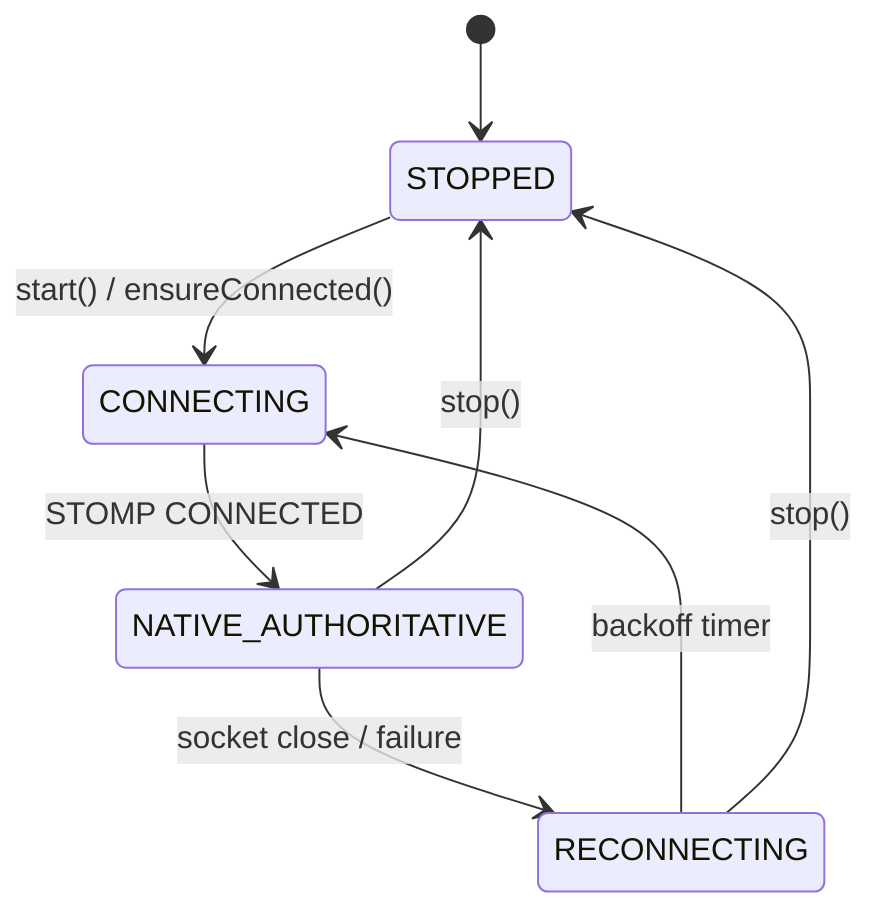
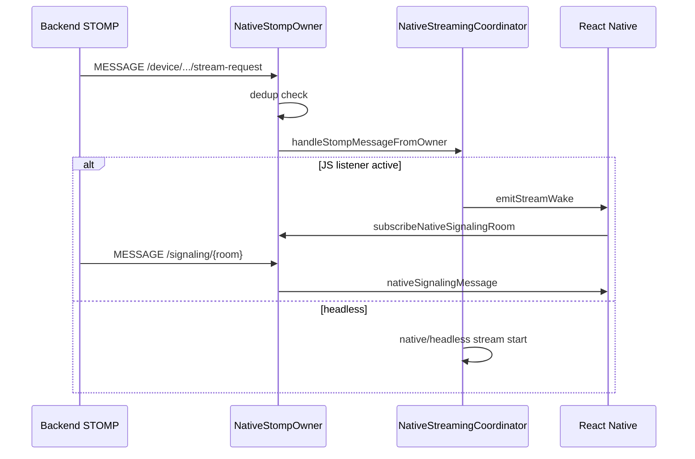

# P1-6: Single STOMP Ownership Architecture

Eliminates dual STOMP ownership between React Native and Native Android on the child device app.

---

## 1. Architecture Audit

### Before (problem)

| Layer | STOMP client | Subscriptions |
|-------|--------------|---------------|
| **Native** `NativeStreamingCoordinator` | `NativeStompClient` (OkHttp) | stream-request, stream-stop, stream-control, commands, policy-updates |
| **React Native** `deviceWebSocket.ts` | `@stomp/stompjs` Client | Same device topics + signaling rooms |

**Failure modes:**
- Duplicate stream-request → double WebRTC negotiation
- Duplicate command delivery → idempotency stress / double execution attempts
- Divergent reconnect — native alive, JS dead after reload
- Background ambiguity — `pauseStreamWebSocketSubscriptions()` partial fix only

### After (P1-6)

| Layer | Role |
|-------|------|
| **`NativeStompOwner`** | Single WebSocket, all subscriptions, reconnect, dedup |
| **`NativeStreamingCoordinator`** | Stream/command routing (no socket ownership) |
| **`stompBridge.ts`** | Signaling-only — native events → JS handlers |
| **Parent app** | Unchanged — single RN STOMP (no dual ownership on parent) |

---

## 2. Recommended Ownership Model

**Native-first authoritative ownership** for child app.

| Criterion | Native-first | JS-first |
|-----------|--------------|----------|
| Background / FGS | ✅ Survives without JS | ❌ Dies with RN |
| Process death recovery | ✅ BootRecoveryEngine | ❌ Requires RN restart |
| WebRTC signaling | Bridge to JS when active | Direct STOMP |
| Command durability | ✅ DeviceCommandProcessor | Duplicate risk |

**Rule:** React Native must never call `Client.activate()` for device STOMP on Android.

---

## 3. State Machine



**JS runtime states (orthogonal):**

| JS state | Stream delivery | Signaling |
|----------|-----------------|-----------|
| Foreground + listener active | `emitStreamWake` → RN WebRTC | `nativeSignalingMessage` events |
| Background / headless | Native capture / headless task | Buffered until JS active (signaling only during stream) |
| RN reload / crash | Native continues; no duplicate STOMP | Resubscribe signaling rooms on bridge init |

---

## 4. File-by-File Changes

| File | Change |
|------|--------|
| `sync/NativeStompOwner.kt` | **NEW** — single owner, dedup, signaling subs |
| `sync/NativeStompClient.kt` | Dynamic subscribe/unsubscribe |
| `sync/NativeStreamingCoordinator.kt` | Delegates STOMP to owner |
| `telemetry/StompOwnershipTelemetry.kt` | **NEW** — mobile telemetry |
| `native/ChildMonitorNativeModule.kt` | Signaling bridge + health APIs |
| `services/stompBridge.ts` | **NEW** — signaling-only bridge |
| `services/deviceWebSocket.ts` | Re-export bridge (no @stomp/stompjs) |
| `services/streamingService.ts` | Native wake only; no device topic subs |
| `services/syncService.ts` | Removed JS command STOMP handler |
| `nativeModules/index.ts` | Bridge method exports |

---

## 5. Code Patches (summary)

### Message flow



### Deduplication

30s TTL LRU cache keyed by `commandId`, `sessionId+roomId`, or `destination+hash`.

---

## 6. Migration Strategy

| Phase | Action |
|-------|--------|
| **1** | Ship native owner + bridge (this PR) |
| **2** | Monitor `stomp_ownership.message_deduplicated` — should trend down after dedup stabilizes |
| **3** | Remove `@stomp/stompjs` from child `package.json` if no other usages |
| **4** | Chaos: NET-06 multi-pod + background/foreground suite |

**Rollback:** Revert to dual-client requires restoring `deviceWebSocket.ts` Client — not recommended.

---

## 7. Testing Plan

| Scenario | Validation |
|----------|------------|
| Background → foreground | Single STOMP connection; `getStompOwnershipHealth().connected` true |
| Foreground → background | Stream continues via native; no JS STOMP |
| JS reload | `ensureNativeStompConnected` restores signaling subs |
| Process kill | BootRecovery → `NativeStompOwner.ensureConnected` |
| Network loss | Native reconnect; no duplicate delivery after restore |
| Active stream + reconnect | ICE/signaling resubscribe via bridge |
| Command during transition | `DeviceCommandProcessor` idempotency + dedup |

```bash
# Manual health check
adb logcat | grep NativeStompOwner
# RN: await getStompOwnershipHealth()
```

---

## 8. Rollout Strategy

1. **Internal dev** — verify pairing, stream, remote control
2. **Staging** — chaos NET-06 + OEM matrix with stream active
3. **Production** — gradual; monitor dedup + `js_stomp_rejected` (should be 0)

---

## 9. Monitoring & Alerts

### Mobile telemetry (`stomp_ownership` category)

| Event | Meaning |
|-------|---------|
| `state_change` | CONNECTING / NATIVE_AUTHORITATIVE / RECONNECTING |
| `message_deduplicated` | Prevented duplicate delivery |
| `signaling_subscribe` | RN joined signaling room via native |
| `js_stomp_rejected` | Legacy JS STOMP attempt (guard) |

### Health API

`getStompOwnershipHealth()` → `{ owner: "native", state, connected, signalingRooms, dedupCacheSize }`

### Suggested alerts

- `device.stomp.disconnected` > 5m while device ONLINE
- `stomp_ownership.message_deduplicated` spike → investigate broker fan-out

---

## 10. Production Readiness Impact

| P0/P1 capability | Impact |
|------------------|--------|
| Command idempotency/durability | No duplicate STOMP-triggered execution |
| Stream teardown | Single session owner; consistent stop path |
| Boot recovery | STOMP owned by native across process death |
| STOMP scaling (P1-1) | One connection per device (correct fan-out semantics) |
| Observability (P1-5) | `stomp_ownership` telemetry ingested via mobile batch |

**PRR gate:** Zero duplicate stream starts in 100-command chaos burst during network flap.
