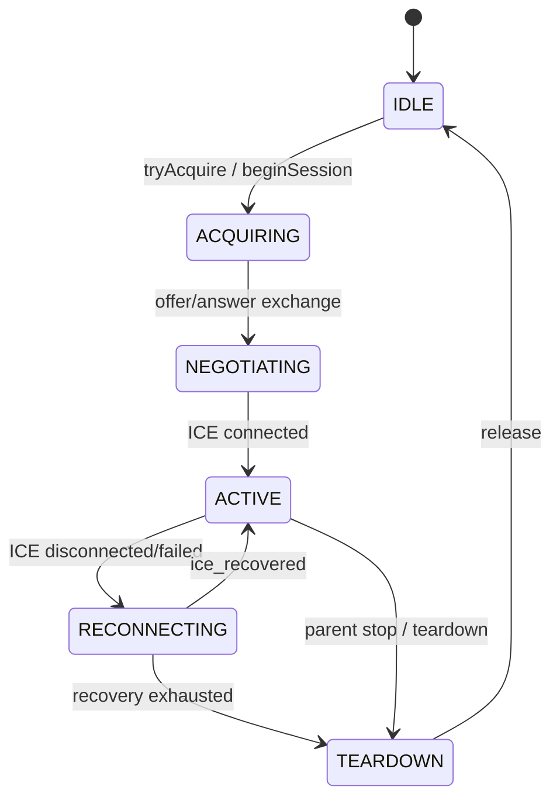
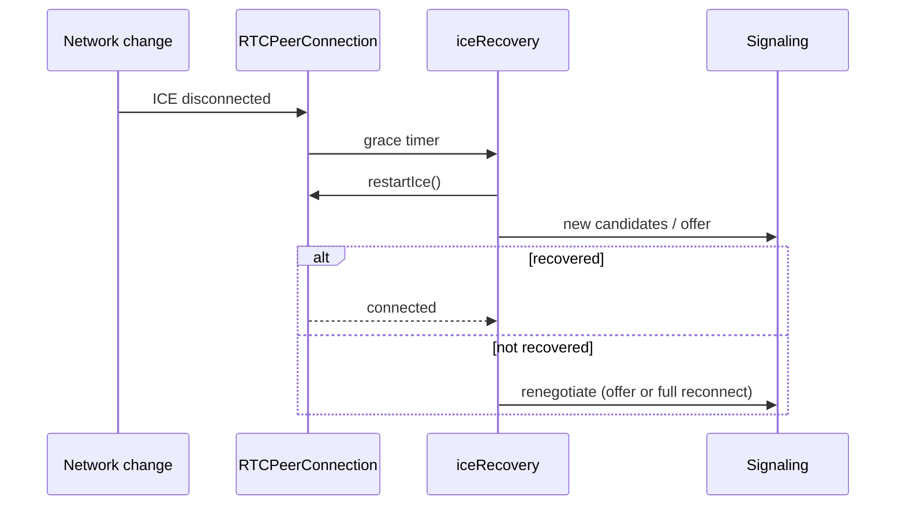

# P1-7: WebRTC Lifecycle Hardening & Session Ownership Unification

Production readiness initiative unifying stream session lifecycle across parent viewer, child JS publisher, and native headless publisher.

---

## 1. Architecture Audit

### Parent (`parent`)

| Component | Before | Risk |
|-----------|--------|------|
| `webrtcService.ts` | Module singleton `onStream` / `onConnectionState` | Stale callbacks after navigation |
| ICE handling | 3s poll on disconnect; full `reconnectParentViewer()` only | No `restartIce`; premature failure |
| Session state | `activeRoomId` only | No correlation ID or phase tracking |

### Child JS (`child/src`)

| Component | Before | Risk |
|-----------|--------|------|
| `webrtcService.ts` | Singleton PC; 10s ICE timer → `reportStreamFailure` | No ICE restart before failure |
| `streamingService.ts` | `nativeStreamActive` flag (never set `true`) | Divergence from native publisher |
| Signaling | Native STOMP owner (P1-6) + HTTP poll fallback | OK |

### Child Native (`child/android`)

| Component | Before | Risk |
|-----------|--------|------|
| `StreamSessionRegistry` | Owner lock only | No lifecycle phases |
| `NativeStreamPublisher` | ICE log only | No recovery |
| `NativeStreamingCoordinator` | `nativeScreenActive` parallel to registry | State drift |

---

## 2. Session Ownership Model

```
┌─────────────────────────────────────────────────────────────┐
│                    AUTHORITATIVE OWNERS                      │
├─────────────────┬───────────────────────┬───────────────────┤
│ Parent viewer   │ streamSessionOwner.ts │ JS only (viewer)  │
│ Child JS path   │ streamSessionOwner.ts │ JS_HIDDEN         │
│ Child native    │ StreamSessionRegistry │ NATIVE_PUBLISHER  │
└─────────────────┴───────────────────────┴───────────────────┘
         │                    │                      │
         └──────── reconcile via getStreamSessionSnapshot()
```

**Rules**

1. Only one owner captures screen at a time (`StreamSessionRegistry`).
2. JS acquires via `acquireJsStreamSession` before `connectChildStream`.
3. Native publisher acquires in `NativeStreamPublisher.start`.
4. Session replacement preempts stale owner with explicit `STREAM_SESSION_REPLACED` log.
5. Correlation IDs: `pv-*` (parent), `ch-*` (child JS), `nat-*` (native).

---

## 3. State Machine



---

## 4. Recovery Architecture

### ICE recovery stages (parent + child JS)

```
ICE disconnected/failed
    → grace period (5–6s parent, 6s child)
    → Stage 1: restartIce() + refresh TURN (parent)
    → wait 8–10s
    → Stage 2: renegotiate (child: ice-restart offer; parent: reconnectParentViewer)
    → wait 12–15s
    → Stage 3: report failure / telemetry (child only after exhaustion)
```

### Native publisher

`NativeStreamPublisher.scheduleIceRecovery()` mirrors JS: IceRestart offer → 12s watchdog.

### Session watchdog

`StreamSessionWatchdog.tick()` on coordinator poll:

- Orphan native owner when `NativeStreamPublisher` not running
- Stuck `ACQUIRING` > 120s → release

---

## 5. File-by-File Changes

| File | Change |
|------|--------|
| `parent/src/services/streamSessionOwner.ts` | **NEW** — scoped listener registry, session phases |
| `parent/src/services/iceRecovery.ts` | **NEW** — ICE restart controller |
| `parent/src/services/webrtcService.ts` | Listener registry, ICE recovery, correlation IDs |
| `parent/src/screens/LiveMonitoringScreen.tsx` | `registerStreamListeners` + cleanup |
| `child/src/services/streamSessionOwner.ts` | **NEW** — JS session owner |
| `child/src/services/iceRecovery.ts` | **NEW** — ICE recovery |
| `child/src/services/webrtcService.ts` | ICE recovery, native registry bridge |
| `child/src/services/streamingService.ts` | Remove `nativeStreamActive`; native reconcile |
| `child/src/nativeModules/index.ts` | Session registry bridge methods |
| `StreamSessionRegistry.kt` | Lifecycle phases, correlation ID, reconcile |
| `NativeStreamPublisher.kt` | ICE restart, markActive |
| `StreamSessionWatchdog.kt` | **NEW** — orphan cleanup |
| `StreamLifecycleTelemetry.kt` | **NEW** — recovery metrics |
| `NativeStreamingCoordinator.kt` | reconcile + watchdog on poll |
| `ChildMonitorNativeModule.kt` | Session bridge + enriched diagnostics |
| `MobileTelemetryService.java` | `stream.ice.*` / `stream.session.*` counters |

---

## 6. Sequence: Network Handoff Recovery



---

## 7. Validation Strategy

| Scenario | Steps | Pass criteria |
|----------|-------|---------------|
| WiFi → Mobile | Start stream; toggle network | ICE reconnects without parent retry |
| Mobile → WiFi | Same | `ice_recovered` telemetry |
| TURN relay loss | Block UDP; rely on TURN | Stage 1–2 recovery before failure |
| Parent navigation | Open live view; go back; reopen | No stale stream callbacks |
| Child app restart | Kill during stream | Orphan cleanup; parent gets clear failure |
| Process kill | `adb shell am kill` | Registry reconcile on boot poll |
| Android 15 FGS timeout | Background > limit | Native watchdog + coordinator poll |
| Session replacement | New session while active | `STREAM_SESSION_REPLACED`; old torn down |

**Manual commands**

```bash
# Diagnostics
adb logcat -s PCP_LIFECYCLE PCP_STREAM_TELEMETRY NativeStreamPublisher

# Network simulation (device)
adb shell svc wifi disable   # switch to mobile
adb shell svc wifi enable
```

---

## 8. Rollout Plan

1. **Canary** — internal parent accounts + OEM-certified devices (P1-10 score ≥ 80).
2. **Monitor** — `stream.ice.recovery.total`, `stream.ice.recovered.total`, `stream.session.failure.total`.
3. **Expand** — 10% → 50% → 100% over 2 weeks if ICE recovery success rate > 85%.
4. **Rollback** — feature flags not required; revert webrtcService + registry if failure rate spikes.

---

## 9. Monitoring & Alerts

| Metric | Alert threshold |
|--------|-----------------|
| `stream.ice.recovery.total` rate | Baseline + 3σ |
| `stream.ice.recovered.total` / attempts | < 70% over 1h |
| `stream.session.failure.total{event=session_orphan}` | > 5/min per device |
| `stream.session.failure.total{event=ice_recovery_failed}` | > 10% of active sessions |

Logcat filter: `PCP_LIFECYCLE`, `PCP_STREAM_TELEMETRY`.

---

## 10. Production Readiness Impact

| P0/P1 dependency | How P1-7 helps |
|------------------|----------------|
| TURN infrastructure | ICE restart before full reconnect reduces TURN churn |
| Stream teardown fix | Unified TEARDOWN phase + watchdog |
| Single STOMP ownership | Coordinator reconcile on same poll loop |
| OEM certification | Recovery telemetry feeds readiness scoring |
| Chaos framework | New scenarios: network handoff, ICE failure injection |

**Readiness delta:** Addresses 6 of 8 streaming failure modes from production review (stale listeners, ICE terminate, no network recovery, JS/native drift, orphan sessions, session replacement).
