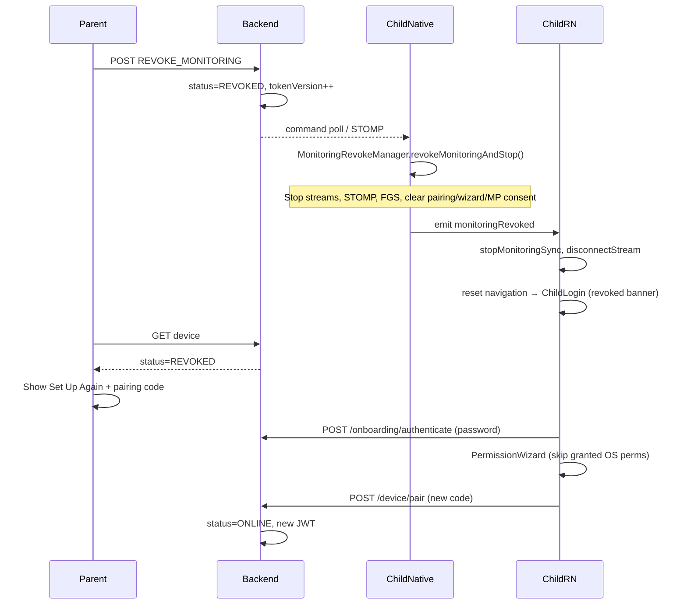

# Revoke Monitoring — Production Flow

## Architecture audit

### Before

| Layer | Issue |
|-------|--------|
| **Native** | Two cleanup paths: `DeviceCommandProcessor.revokeMonitoring()` (partial) vs `ChildMonitorNativeModule.revokeMonitoringAndStop()` (broader) |
| **React** | No listener for revoke — child stayed on wizard/dashboard until restart |
| **Parent** | Device detail always showed live monitoring controls even when `REVOKED` |
| **Backend** | Revoked devices returned generic `UNAUTHORIZED` without `REPAIR_REQUIRED` code |
| **Wizard** | Worked in theory (OS checks) but wizard session wasn't always cleared atomically with native |

### After

| Layer | Single source of truth |
|-------|------------------------|
| **Native** | `MonitoringRevokeManager.revokeMonitoringAndStop()` — called from device commands and JS bridge |
| **React** | `monitoringRevokeHandler.ts` listens for `monitoringRevoked` → navigates to `ChildLogin` |
| **Parent** | `DeviceDetailScreen` shows Revoked badge + Set Up Again flow |
| **Backend** | `ErrorCode.REPAIR_REQUIRED` on revoked / stale token device APIs |

---

## Current vs proposed flow



---

## Navigation flow (child)

```
[Any screen]
    → monitoringRevoked event
    → ChildLogin { revokedByParent: true }
    → PermissionWizard (skips granted permissions)
    → Pairing (new code)
    → ServiceStatus (dashboard)
```

---

## State machine

| Device status | Child paired | Parent UI | Child UI |
|---------------|--------------|-----------|----------|
| ONLINE | yes | Full monitoring | ServiceStatus |
| OFFLINE | yes | Full monitoring | ServiceStatus |
| **REVOKED** | no (cleared) | Revoked + Set Up Again | ChildLogin |

---

## What revoke clears vs preserves

**Cleared:** pairing token, HMAC, wizard JSON, MediaProjection consent, STOMP, streams, FGS, kiosk, wizard step, onboarding session.

**Preserved:** Accessibility, Usage Access, Overlay, Notifications, Battery exemption, Auto Start, Location (OS-level grants).

---

## Regression checklist

- [ ] Revoke during screen share → stream stops, no crash
- [ ] Revoke during camera/audio → FGS stopped
- [ ] Revoke on Permission Wizard step 12 → immediate ChildLogin
- [ ] Revoke while app backgrounded → login on return
- [ ] Duplicate REVOKE_MONITORING → idempotent, no ANR
- [ ] Parent shows Revoked badge after reload
- [ ] Set Up Again generates code; child re-pairs successfully
- [ ] Heartbeat with old token → `403 REPAIR_REQUIRED`
- [ ] start-stream on revoked device → `403 REPAIR_REQUIRED`
- [ ] OS permissions remain; only screen capture re-requested

---

## Test plan

1. **Backend:** `SecurityIntegrationTest.rejectsRevokedDeviceToken` expects `REPAIR_REQUIRED`
2. **Manual E2E:** Parent revoke → child on login within 1s → parent revoked UI → re-pair
3. **adb:** After revoke, `dumpsys package` still shows accessibility service enabled

---

## Key files

- `child/android/.../MonitoringRevokeManager.kt`
- `child/src/services/monitoringRevokeHandler.ts`
- `child/src/screens/ChildLoginScreen.tsx`
- `parent/src/screens/DeviceDetailScreen.tsx`
- `backend/.../ErrorCode.java` (`REPAIR_REQUIRED`)
- `backend/.../DeviceTokenValidationService.java`
