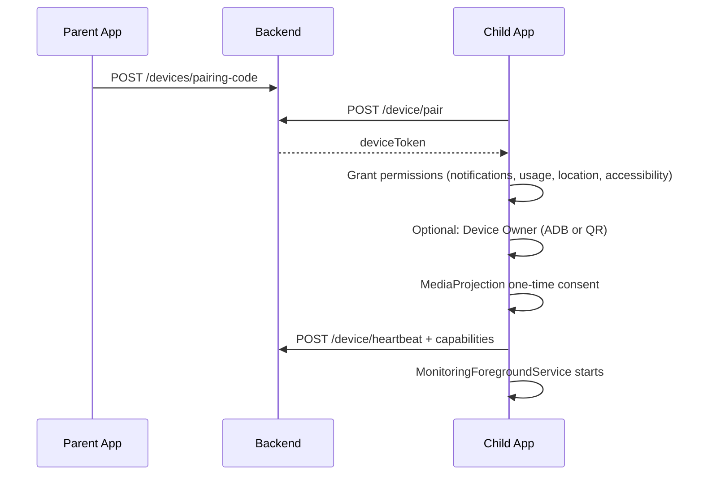

# parental-control-child-app

React Native shell + native Android (Kotlin) agent that runs on the **child device**: monitoring sync, app blocking, Device Owner provisioning, one-time MediaProjection consent, and silent screen streaming via WebRTC.

**Runs on:** Child Android devices only  
**Backend contract:** `API_CONTRACT_VERSION=1.0.0` (see [parental-control-backend](https://github.com/YOUR_ORG/parental-control-backend))

---

## Overview

| Feature | Native component |
|---------|------------------|
| Device Owner provisioning | `DeviceOwnerManager`, `device_owner_provisioning.xml` |
| Device Admin | `ChildDeviceAdminReceiver` |
| One-time screen consent | `MediaProjectionConsentActivity`, `MediaProjectionTokenStore` |
| Silent screen capture | `ScreenCaptureForegroundService`, `NativeStreamPublisher` |
| Monitoring sync | `MonitoringForegroundService`, `NativeSyncUploader` |
| App blocking | `AppBlockingAccessibilityService`, `BlockOverlayActivity` |
| Policy enforcement | `PolicyEnforcementEngine`, `PolicySyncManager` |
| Tamper resistance | `TamperProtectionManager` (hide launcher) |
| Boot persistence | `BootReceiver` |
| Optional kiosk | Lock Task Mode via `DeviceOwnerManager` |

**Design principle:** Enforcement and capture run in **Kotlin foreground services**. React Native provides setup UI, pairing, and status screens only.

---

## Tech stack

| Layer | Choice |
|-------|--------|
| UI shell | React Native 0.76+ / TypeScript |
| Native | Kotlin, Android SDK 34+ |
| WebRTC | Native publisher (`org.webrtc`) in Kotlin |
| HTTP | OkHttp (native sync) + Axios (RN) |
| Real-time | STOMP (stream requests) |
| Bridge | `ChildMonitorNativeModule` |

---

## Repository structure

```
parental-control-child-app/
├── .github/workflows/
│   ├── ci.yml
│   └── android-enterprise.yml
├── android/app/src/main/java/com/childmonitor/
│   ├── ChildDeviceAdminReceiver.kt
│   ├── deviceowner/
│   │   ├── DeviceOwnerManager.kt
│   │   ├── MediaProjectionConsentActivity.kt
│   │   └── ProvisioningSuccessActivity.kt
│   ├── capture/
│   │   ├── ScreenCaptureForegroundService.kt
│   │   ├── MediaProjectionTokenStore.kt
│   │   ├── ScreenCaptureController.kt
│   │   ├── NativeStreamPublisher.kt
│   │   └── SignalingHttpClient.kt
│   ├── policy/
│   │   ├── PolicySyncManager.kt
│   │   ├── PolicyEnforcementEngine.kt
│   │   └── AppBlockingAccessibilityService.kt
│   ├── sync/
│   │   ├── MonitoringForegroundService.kt
│   │   ├── NativeSyncUploader.kt
│   │   └── BootReceiver.kt
│   ├── native/
│   │   └── ChildMonitorNativeModule.kt
│   └── TamperProtectionManager.kt
├── android/app/src/main/res/xml/
│   ├── device_admin_policies.xml
│   └── device_owner_provisioning.xml
├── src/
│   ├── nativeModules/index.ts    # JS bridge API
│   ├── services/
│   │   ├── api.ts
│   │   ├── syncService.ts
│   │   ├── streamingService.ts
│   │   └── policyService.ts
│   └── screens/
│       ├── DeviceOwnerSetupScreen.tsx
│       ├── PermissionSetupScreen.tsx
│       └── ServiceStatusScreen.tsx
├── docs/
│   ├── DEVICE_OWNER_SETUP.md
│   └── TESTING_DEVICE_OWNER.md
├── contracts/
│   └── openapi-v1.0.0.yaml
├── .env.example
├── package.json
└── README.md
```

---

## Prerequisites

- Node.js 18+
- Android Studio + SDK 34+
- JDK 17+
- Child device or emulator (API 26+; Device Owner requires factory-reset device or dedicated test hardware)
- Running backend ([parental-control-backend](https://github.com/YOUR_ORG/parental-control-backend))
- Parent app to generate pairing code ([parental-control-parent-app](https://github.com/YOUR_ORG/parental-control-parent-app))

---

## Quick start

```bash
npm install
cp .env.example .env
npm start
```

```bash
npm run android
```

### Emulator API URL

```env
API_BASE_URL=http://10.0.2.2:8080
WS_URL=ws://10.0.2.2:8080/ws-native
```

---

## Environment variables

| Variable | Required | Description |
|----------|----------|-------------|
| `API_BASE_URL` | Yes | Backend REST base |
| `WS_URL` | Yes | STOMP for stream-request topics |
| `API_CONTRACT_VERSION` | Yes | Pinned OpenAPI version |
| `ENABLE_SSL_PINNING` | Prod | `true` in release builds |
| `CERT_PINS` | Prod | SHA-256 SPKI pins |

---

## Setup flow (child device)



### Step-by-step

1. **Pair** — Enter 8-character code from parent app; accept child consent.
2. **Permissions** — Notification listener, usage access, location, accessibility (for app blocks).
3. **Device Admin** (recommended) — Uninstall protection until admin deactivated.
4. **Device Owner** (optional, `FULL` protection) — See [docs/DEVICE_OWNER_SETUP.md](docs/DEVICE_OWNER_SETUP.md).
5. **MediaProjection** — One-time system dialog; token stored for silent re-capture.
6. **Service status** — Confirm foreground service and last sync time.

---

## Device Owner provisioning (M1)

Device Owner enables stronger policies (uninstall block, silent screen after consent, kiosk).

**Development (ADB, no accounts on device):**

```bash
adb shell dpm set-device-owner com.childmonitor/.ChildDeviceAdminReceiver
```

Or use in-app **Device Owner setup** screen for the exact command.

**Production:** NFC / QR provisioning via `device_owner_provisioning.xml` and enterprise MDM.

> Device Owner cannot be set if the device has a Google account or multiple users (typical consumer phones). Use a dedicated child device or work profile strategy.

---

## MediaProjection consent (M2)

- Shown **once** via `MediaProjectionConsentActivity`.
- Token persisted in `MediaProjectionTokenStore` (encrypted).
- Subsequent streams use `ScreenCaptureForegroundService` without re-prompting.
- Parent **revoke** clears token and stops capture (`revokeMonitoringAndStop`).

---

## Silent screen streaming (M3)

1. Parent starts stream → backend notifies child (`/topic/device/{id}/stream-request`).
2. Native layer: `startNativeScreenStream(roomId, sessionId)`.
3. `NativeStreamPublisher` posts offer/ICE via `SignalingHttpClient`.
4. Parent answers through API; WebRTC media flows (STUN/TURN from backend).

Bridge API (`src/nativeModules/index.ts`):

```typescript
nativeModules.getDeviceCapabilities()
nativeModules.requestMediaProjectionConsent()
nativeModules.startNativeScreenStream(roomId, sessionId)
nativeModules.stopNativeScreenStream()
nativeModules.revokeMonitoringAndStop()
```

---

## Capability flags (M4)

Reported on heartbeat and via `getDeviceCapabilities()`:

| Field | Description |
|-------|-------------|
| `deviceOwner` | Device Owner active |
| `mediaProjectionGranted` | Consent granted and token valid |
| `silentScreenCapture` | Native publisher ready |
| `protectionLevel` | `STANDARD` \| `DEVICE_OWNER` \| `FULL` |

---

## Android permissions

| Permission / access | Purpose |
|-------------------|---------|
| `INTERNET` | API sync |
| `FOREGROUND_SERVICE` (+ types) | Monitoring & screen capture |
| `RECEIVE_BOOT_COMPLETED` | Restart after reboot |
| `POST_NOTIFICATIONS` | FG service notification (Android 13+) |
| `ACCESS_FINE_LOCATION` / background | Location history & geofences |
| `PACKAGE_USAGE_STATS` | Screen time |
| Notification listener (special) | Notification capture |
| Accessibility (special) | App blocking |
| MediaProjection (runtime) | Screen capture |
| Device Admin / Device Owner | Tamper protection, kiosk |

---

## React Native bridge

All native features are exposed through `ChildMonitorNativeModule` and re-exported in `src/nativeModules/index.ts`. Prefer calling native methods for:

- Starting/stopping foreground services
- Device Owner and MediaProjection state
- Screen stream lifecycle
- Policy sync triggers

---

## Scripts

| Command | Description |
|---------|-------------|
| `npm start` | Metro bundler |
| `npm run android` | Build & install debug APK |
| `npm run lint` | ESLint |

**Gradle (from `android/`):**

```bash
./gradlew :app:assembleDebug
./gradlew :app:testDebugUnitTest
./gradlew :app:lintDebug
```

---

## Testing

### Unit (Kotlin)

```bash
cd android && ./gradlew :app:testDebugUnitTest
```

### Manual

See [docs/TESTING_DEVICE_OWNER.md](docs/TESTING_DEVICE_OWNER.md).

| Test | Expected |
|------|----------|
| Pair with valid code | Device token saved, FG service running |
| Notification on child | Appears in parent app after sync |
| Block Chrome policy | Overlay on launch |
| Reboot | Service restarts, sync resumes |
| Device Owner + MP consent | `protectionLevel: FULL`, silent stream |
| Revoke monitoring | Capture stops, token cleared |

---

## CI/CD

- **ci.yml:** `npm ci`, lint, Gradle unit tests + lint
- **android-enterprise.yml:** Signed release APK, SBOM, provisioning doc artifact

Distribute via **enterprise MDM** or managed Play (not consumer Play without clear disclosure).

---

## Security

- Device token + HMAC on all ingest POSTs (secret issued at pair)
- Encrypt MediaProjection token at rest (Android Keystore)
- Certificate pinning in release builds
- No parent-action popups on child device during passive monitoring
- Block overlay only when child violates a policy

---

## Remote commands (from parent via backend)

| Command | Native action |
|---------|---------------|
| Block app | Policy sync + accessibility block |
| Enable kiosk | `DeviceOwnerManager` Lock Task |
| Revoke monitoring | Clear MP token, stop `ScreenCaptureForegroundService` |

---

## Related repositories

| Repo | Role |
|------|------|
| [parental-control-backend](https://github.com/YOUR_ORG/parental-control-backend) | API, signaling, audit |
| [parental-control-parent-app](https://github.com/YOUR_ORG/parental-control-parent-app) | Parent dashboard |

---

## Known limitations

- **Android only** — no iOS child agent
- Device Owner requires provisioning constraints (no user accounts)
- WebRTC may need TURN in production NAT environments
- App-store distribution of silent capture is restricted; use enterprise / owned-device deployment

---

## Legal

Install only on devices you own or have legal authority to monitor. Obtain informed consent from guardians and age-appropriate notice for children as required by local law.

---

## License

[YOUR LICENSE]
