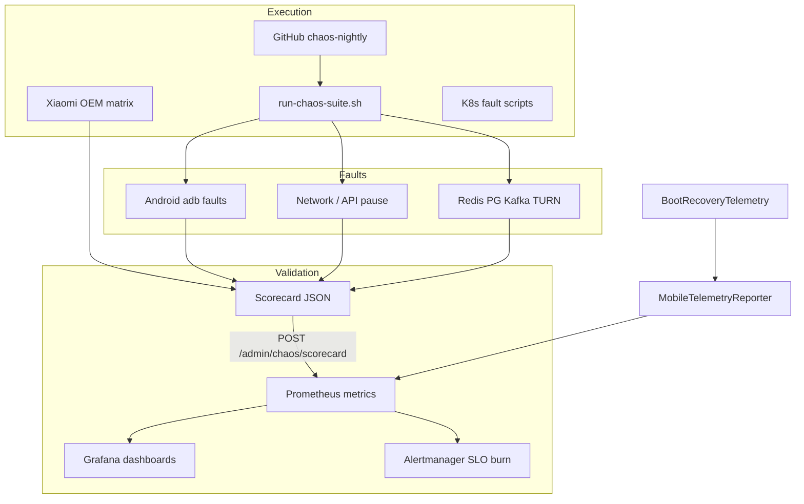

# Chaos Engineering & Reliability Validation Framework

Continuous verification that the Parental Control Platform survives Android process death, OEM kills, network failures, backend outages, and infrastructure faults.

## Architecture



## Quick start

```bash
# Local backend chaos (requires Podman stack)
./scripts/dev/compose.sh up -d postgres redis backend
chmod +x scripts/chaos/run-chaos-suite.sh scripts/chaos/scenarios/**/*.sh
./scripts/chaos/run-chaos-suite.sh --suite ci-backend

# Nightly suite with device
export DEVICE_SERIAL=<adb-serial> DEVICE_ID=<uuid> PARENT_TOKEN=<jwt>
./scripts/chaos/run-chaos-suite.sh --suite nightly

# OEM matrix (Xiaomi validation)
./scripts/chaos/run-chaos-suite.sh --suite oem-matrix

# Single scenario
./scripts/chaos/run-chaos-suite.sh --scenario BE-03
```

## Test matrix

Full scenario catalog: [`test-matrix.yaml`](test-matrix.yaml)

| Domain | Scenarios | Automation |
|--------|-----------|--------------|
| Android | AND-01..08 | adb scripts + Xiaomi framework |
| Networking | NET-01..06 | compose pause + adb |
| Backend | BE-01..07 | compose + kubectl |
| Streaming | STR-01..05 | turn-outage + manual |

## Pass/fail criteria

| Scenario class | Pass | MTTR target |
|----------------|------|-------------|
| Process kill | Service + heartbeat < 60s | 60s |
| Reboot | ONLINE < 10m | 600s |
| Redis outage | API recovery < 90s | 90s |
| Command burst (100) | ≥90% health checks pass during fault | — |
| Stream + TURN down | Failure reported to metrics | — |

Scorecard schema: [`scorecard-schema.json`](scorecard-schema.json)

## Metrics & KPIs

| Metric | Purpose |
|--------|---------|
| `chaos.experiment.total{scenario,status}` | CI/farm run outcomes |
| `chaos.recovery.mttr.seconds` | Recovery time distribution |
| `device.boot.phase.total{phase,success}` | Boot chain phases |
| `device.boot.recovery.total{success,trigger}` | Boot SLO |
| `command.sent/executed/failure.total` | Command durability |
| `stream.start/failure.total` | Streaming reliability |

Dashboard: `infra/observability/grafana/dashboards/pcp-reliability-chaos.json`

## CI/CD integration

- **PR/merge:** `ChaosReliabilityIntegrationTest` (via backend-ci or chaos workflow)
- **Nightly:** `.github/workflows/chaos-nightly.yml` — infra up + `ci-backend` suite
- **Pre-release:** `--suite nightly` + OEM matrix on device farm
- **Scorecard ingest:** `POST /api/v1/admin/chaos/scorecard` (admin JWT via `ADMIN_TOKEN`)
- **Alert validation:** `./scripts/chaos/validate-alerts.sh` after nightly run

## Related docs

- **Full framework (10 sections):** [`docs/RELIABILITY-CHAOS-FRAMEWORK.md`](../../docs/RELIABILITY-CHAOS-FRAMEWORK.md)
- SLOs: `infra/observability/SLO.md`
- Runbooks: `infra/observability/RUNBOOKS.md`
- Android 15 FGS: `docs/android15-fgs-test-plan.md`
- Xiaomi validation: `scripts/validation/xiaomi/README.md`
- STOMP multi-pod: `scripts/test/stomp-multi-pod-smoke.sh`
